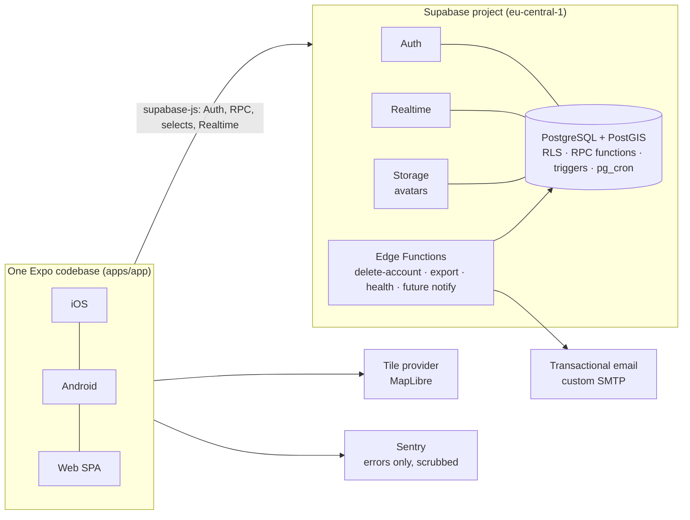

# Architecture

Status: Phase 0 blueprint, **updated with the as-built Phase 1 foundation** (§3 layout and §6.7 installed versions are authoritative where they differ from earlier text) · Style: **modular monolith** on Supabase · Decisions recorded in [ADR/](ADR/)

Related: [DATABASE](DATABASE.md) · [SECURITY](SECURITY.md) · [TESTING](TESTING.md) · [DEPLOYMENT](DEPLOYMENT.md)

## 1. System overview



Core idea: **authoritative business logic lives in PostgreSQL** (transactional RPC functions, constraints, RLS, cron). Edge Functions exist only where secrets, third-party calls or the Auth admin API are needed. The client is a typed, validated, optimistic-where-safe presentation layer.

## 2. Principles

- Modular monolith; no microservices (ADR-0001).
- Server-authoritative state transitions; the client never decides capacity, eligibility, scores or roles.
- One code path per rule: rules are expressed once in SQL and mirrored in `packages/domain` only as (a) UX pre-validation using the same Zod schemas / constants and (b) executable reference specs for tests.
- Typed contracts: DB types generated from the schema; RPC wrappers parse responses with Zod at the boundary.
- Secure defaults; least privilege; no secrets in clients.
- Small, tested vertical slices; keep it buildable at every step.
- Avoid speculative abstraction; put seams only where the roadmap names a concrete consumer (§10).

## 3. Repository layout (target; created in Phase 1)

```
matchup/
  apps/
    app/                      # Expo app: iOS + Android + Web (Expo Router)
      app/                    #   routes only — thin, delegate to features
      src/
        features/<module>/    #   api/ hooks/ components/ screens/ schemas/ index.ts
        ui/                   #   design-system components + tokens/theme
        lib/                  #   supabase client, query client, i18n, logger, env
        locales/{tr,en}/      #   translation resources
  packages/
    domain/                   # pure TS, zero runtime deps beyond zod: schemas, error codes,
                              #   state-machine tables, level formula, rating/reliability/XP
                              #   reference implementations, constants, golden test vectors
    config/                   # branding (name, tagline, URLs, meta), app-wide constants (no secrets)
  supabase/
    migrations/  functions/  seed/  tests/  config.toml
  docs/  scripts/  .github/workflows/
  eslint.config.mjs  tsconfig.base.json  prettier.config.mjs  pnpm-workspace.yaml
```

Deliberately **not** created yet: `apps/web` (Expo Web suffices, §7), `packages/ui` (extract only when a second consumer exists — e.g. a separate admin app), `packages/shared`/`packages/api-client` (premature).

### Dependency rules (enforced by lint, `eslint-plugin-boundaries` or import restrictions)
- `app/` routes → `features` only.
- `features/*` → `ui`, `lib`, `@matchup/domain`, `@matchup/config`; **cross-feature imports only through a feature's `index.ts`**.
- Data access (supabase calls) only in `features/*/api`. Components never call Supabase.
- `packages/domain` imports nothing from apps; `packages/config` imports nothing.
- `supabase/functions` may import `packages/domain` for schemas/constants (bundling risk: ADR-0007).

## 4. Client architecture

- **Routing:** Expo Router (file-based). Groups: `(auth)`, `(onboarding)`, `(tabs)` [Discover, My Events, Create, Profile], `(admin)` [web-only, lazy], reserved `(community)` hidden in MVP. Public routes (Discover, event detail, auth screens) are open to guests; protected route groups redirect to sign-in with a `returnTo` parameter (D-09, ADR-0013) — the guard is UX only, the server enforces everything; deep links: `matchup://` scheme + universal/app links `https://<domain>/e/<id>`.
- **Responsive:** mobile = bottom tabs; ≥ 768 px = side rail; ≥ 1200 px = side nav with a two-pane master/detail for Discover. Layout breakpoints are tokens (UI_DESIGN_SYSTEM §6).
- **Server state:** TanStack Query. Query keys are factories per feature (`eventKeys.list(filters)`), stale/GC times per resource class, `placeholderData` for pagination, optimistic updates **only** for idempotent low-risk actions (mark notification read), never for capacity-affecting actions. Persist the query cache (non-sensitive lists) for fast cold start and offline read.
- **Client state:** React state/context for session, theme, locale; no global store library.
- **Forms:** React Hook Form + Zod resolver; the same Zod schemas validate RPC inputs client-side for UX; the server revalidates.
- **Errors:** RPC errors map to `DomainErrorCode` → localized messages; unexpected errors reported to Sentry with scrubbing; every screen has loading / empty / error / offline states.
- **i18n:** i18next + `expo-localization`; keys namespaced per feature; `tr` default; ICU-style plural handling; user locale stored in `user_settings`. Lint rule against hard-coded UI strings.
- **Auth storage:** native — session encrypted at rest (AES key in `expo-secure-store`, ciphertext in AsyncStorage, because SecureStore values are size-limited); web — Supabase default storage with strict CSP (SECURITY §3).
- **Images:** `expo-image` with caching, avatar upload resized client-side to ≤ 512 px, MIME/size validated client- and server-side (Storage policies).
- **Realtime:** one channel per open screen (notifications for self; `approved_count` for the open event), always unsubscribed on blur; polling fallback.
- **Offline:** read-only cached lists; mutations fail fast with a clear retry UI (no offline mutation queue in MVP, to avoid replaying stale capacity decisions).
- **Maps (Phase 4):** a `MapView` abstraction with `.native.tsx` (MapLibre RN, needs a dev build) and `.web.tsx` (maplibre-gl); clustering client-side; viewport-bbox queries capped (e.g. 200 events).

## 5. Backend architecture

| Concern | Mechanism |
|---|---|
| Authentication | Supabase Auth (email + password, email verification required, CAPTCHA on sign-up/reset, MFA TOTP for admins) |
| Authorization | RLS for reads; RPC functions for writes with explicit checks (DATABASE §9–10) |
| Business logic | PL/pgSQL RPCs; triggers for invariants; `pg_cron` jobs call SQL functions directly |
| Capacity concurrency | event-row `FOR UPDATE` lock + constraint trigger (DATABASE §8) |
| Notifications | Row inserted in the same transaction (transactional outbox); in-app via Realtime/poll; push/email dispatchers later read the same table |
| Privileged side effects | Edge Functions (Deno): `delete-account`, `export-my-data`, `health`; later `notify-dispatch` |
| Storage | `avatars` bucket only. Public bucket with unguessable object names vs. short-lived signed URLs is open decision D-10 (recommended: public bucket for avatars, because signed URLs defeat list caching); per-user path policy, 2 MB limit, image MIME allowlist |
| Rate limiting | Per-user quota counters inside RPCs (create ≤ 5 events/day, requests ≤ 30/day, reports ≤ 20/day, etc.), Auth built-in limits + CAPTCHA, Cloudflare/WAF in front of the web host and custom API domain for IP-level limits |
| Config & secrets | Public config via `EXPO_PUBLIC_*` (URL, anon key, Sentry DSN, map style URL); server secrets only in Supabase/hosting secret stores |

**Why SQL-centric.** Atomic multi-row state changes with row locking and RLS are native strengths of Postgres; Edge Functions add network hops and cannot span a transaction across multiple calls. Costs: PL/pgSQL is harder to test/refactor than TypeScript. Mitigation: small functions, pgTAP + integration tests, TS reference specs for the scoring math, and strict conventions (ADR-0003/0004).

### Modules (bounded contexts) and their tables

| Module | Owns | Phase |
|---|---|---|
| identity | profiles, settings, consents, sport profiles, admins | 1–2 |
| catalog | sports, formats, positions | 2–3 |
| geo | cities, districts, venues | 3–4 |
| events | events, private details, participations, disputes | 3, 5 |
| progression | reviews, ratings, reliability, XP, achievements | 5 |
| notifications | notifications (+ future delivery tables) | 3, 6 |
| safety | reports, blocks, moderation, audit | 6 |
| ops | rate limits, analytics, jobs | 3, 7 |

Cross-module reads happen through views/RPCs, not ad-hoc joins in client code.

## 6. Technology stack and pinned versions

Versions were read from the npm registry and Expo's own SDK manifest (`bundledNativeModules.json`) on **2026-10-24**. They must be re-verified in Phase 1 milestone M0 with `npx expo install --check` / `expo-doctor`. Expo-managed packages are installed with `npx expo install` (never hand-pinned to a different version).

### 6.1 Runtime and toolchain

| Component | Version | Notes |
|---|---|---|
| Node.js | **24.x** (≥ 24.3 required by Expo 58; local 24.11.1 ✔) | `.nvmrc` + `engines` |
| pnpm | **10.33.x** (installed locally) | latest on npm is 12.x; not adopted until Expo monorepo behavior is verified. Fallback: `node-linker=hoisted` in `.npmrc` if Metro resolution problems occur (M0 spike) |
| TypeScript | **~6.0.3**, `strict` + `noUncheckedIndexedAccess` | Expo SDK 57/58 templates pin ~6.0.3. TS 7.0.x exists on npm; **do not adopt** until Expo/RN toolchain support is confirmed |
| ESLint | **9.39.x** (maintenance line) + `eslint-config-expo ~58.0.4` | ESLint 10 is `latest`; adopt only if the M0 spike shows all plugins support it |
| Prettier | ^3.9 | |
| Git hooks | husky ^9.1 + lint-staged | |

### 6.2 App (Expo SDK — decision D-01)

| Component | **Recommended: SDK 58** | Fallback: SDK 57 |
|---|---|---|
| expo | ~58.0.x (58.0.19 → 58.0.28 seen) | ~57.0.31 |
| react / react-dom | 19.3.0 | 19.2.3 |
| react-native | 0.88.0 | 0.86.3 |
| react-native-web | ~0.21.4 | ~0.21.0 |
| expo-router | ~58.0.26 | ~57.0.29 |
| react-native-reanimated / worklets | 4.7.1 / 0.13.0 | 4.5.1 / — |
| react-native-screens | ~4.30.0 | ~4.26.0 |
| react-native-safe-area-context | ~5.10.1 | per SDK |
| react-native-gesture-handler | ~3.3.0 | per SDK |
| expo-secure-store / expo-localization / expo-image / expo-location | ~58.0.2 / ~58.0.5 / ~58.0.17 / ~58.0.19 | per SDK |
| expo-notifications (post-MVP) | ~58.1.6 | per SDK |

**Why SDK 58 despite being new:** SDK 58 (npm `58.0.0`: 2026-09-29; upgrade guide: 2026-10-21; already at 58.0.x patch 19+) gives the longest runway before a forced upgrade, iOS 27/Xcode 27 support (app store submission requirements move with Xcode), and RN 0.88. **Costs/risks:** (1) the new Expo Go "supports only SDK 58" and was announced as arriving on the stores "in the next few weeks" — until then use dev builds; (2) ecosystem libraries may lag; (3) breaking changes (`InteractionManager`, `Touchable`, `Modal.animated` removed; strict TS API default; `web.output` default now `server`; Android R8 on by default). **Why dev builds are needed anyway:** MapLibre native (Phase 4) and push (post-MVP) cannot run in Expo Go; on Windows, iOS builds require EAS Build (cloud) and an Apple Developer account. **Gate:** M0 verifies install, web export, tests and an Android dev build; failing that, fall back to SDK 57 (same architecture, one SDK step to upgrade later).

Web config for MVP: `web.output: "single"` (SPA, static hosting) — ADR-0002.

### 6.3 Data, forms, i18n, observability

| Component | Version | Notes |
|---|---|---|
| @supabase/supabase-js | ^2.118 (Node ≥ 22) | |
| Supabase CLI (dev dependency) | ^2.122 | needs Docker (Windows: Docker Desktop + WSL2) for local stack |
| Supabase Postgres | project default at creation (record in DEPLOYMENT) | extensions: `postgis` (schema `extensions`), `pg_cron`, `unaccent`, `pg_trgm`, `pgcrypto`; verify availability per plan |
| @tanstack/react-query | ^5.104 | |
| zod | ^4.6 | shared with `packages/domain` |
| react-hook-form + @hookform/resolvers | ^7.91 + ^6.0 (supports Zod 4) | |
| i18next / react-i18next | ^26.5 / ^17.1 | |
| @sentry/react-native | ^8.32 | PII scrubbing, no session replay in MVP |

### 6.4 Testing

| Layer | Tooling |
|---|---|
| Pure TS (`domain`) + DB integration/concurrency | **Vitest ^5.0** (`pg` ^8.23 for multi-connection tests) |
| RN components | **jest-expo ~58.0.12 (Jest 30; peers `@react-native/jest-preset`, `test-renderer`)** + `@testing-library/react-native ^14.1` (peer `test-renderer ^1`) — Vitest cannot run the RN preset reliably, hence two runners (ADR-0008) |
| Web E2E + a11y | **@playwright/test ^1.64**, `@axe-core/playwright ^4.14` |
| DB schema/RLS | pgTAP via `supabase test db` |
| Mobile E2E | Maestro (flows) against dev builds — post-Phase 3, optional until pilot |
| Load | k6 (external tool, not an app dependency) |

### 6.5 Later phases
`@maplibre/maplibre-react-native ^11.5` (peer `expo ≥ 54`), `maplibre-gl ^6.15`, `supercluster ^9`, `expo-notifications`. Tile provider decision in Phase 4 (§13).

### 6.6 Explicitly not used
Next.js (ADR-0002), Redux/Zustand (no need), GraphQL, microservices, ORMs (generated types + RPC), CSS-in-JS/utility styling libs (styling decision **deferred until `design.md` is received**; default is `StyleSheet` + typed tokens + `useTheme()`).

## 7. Key tradeoffs

| Decision | Chosen | Alternative | Why / what we give up |
|---|---|---|---|
| Web | Expo Web SPA | Next.js app | One UI codebase, solo-dev friendly. Give up: SEO and rich link previews for event pages. Mitigation: a tiny edge function/worker serving OG-tag HTML for `/e/:id` crawlers when sharing matters (post-MVP); revisit Next.js only if organic search becomes a growth channel |
| Business logic | SQL RPCs | Edge Functions/TS | Atomicity + RLS integration. Give up: easier TS testing; mitigated per §5 |
| Test runners | Vitest + Jest | Jest only | Vitest speed/DX for pure logic; Jest needed for RN preset |
| Admin UI | Web-only route group in same app | Separate admin app | Zero extra infra. Give up: admin code ships in the client bundle (no secrets; authorization server-side; lazy-loaded) |
| Analytics | First-party table + Sentry | PostHog/GA | Less cross-border transfer and consent surface. Give up: rich analysis tooling (export to BI later) |
| Maps | MapLibre + commercial/self-hosted tiles | Google Maps / react-native-maps | Licensing clarity, one library web+native, no per-load Google billing; cost: dev builds, own tile hosting/provider |
| Notifications | In-app first | Push first | Faster to reliable; give up reach (risk R-8) |

## 8. Performance budgets and load-test plan

Budgets are **targets to validate by measurement**; nothing is claimed achieved.

| Metric | Budget |
|---|---|
| p95 standard RPC / select (server time + network from Istanbul/Ankara to eu-central-1) | < 500 ms |
| p95 `search_events` (city filter + radius + filters, page of 20) at pilot load | < 800 ms |
| Approve/join RPC under contention on one event | p95 < 500 ms; zero capacity violations |
| App cold start to interactive (mid-range Android, e.g. 4 GB RAM, 2021-class) | < 3 s (measure); web LCP < 2.5 s on 4G |
| JS bundle (web, gzip) initial route | < 350 kB; admin and map code lazy-loaded |
| List scrolling | no dropped-frame regressions in 100-item list (profile with Flashlight/Perfetto before pilot) |
| Query plans | no sequential scans on `events`/`event_participations` at 100k rows; no N+1 (one RPC per screen) |

**Pilot sizing assumption (to be revised):** 3,000 registered, 500 DAU, evening peak (18:00–22:00) 40 concurrent users, ≈ 15 read rps / 3 write rps, 800 live events.

**Load scenarios (k6 against staging with seeded 100k events / 500k participations to test index behavior):**
1. *Discovery browse:* 100 virtual users paginate `search_events` with random filters + radius.
2. *Event detail + join storm:* 200 users request to join one popular event within 60 s.
3. *Last-slot race:* 50 parallel `approve_participation` calls on one event with 1 free slot → exactly 1 succeeds (also a Vitest concurrency test, not only load).
4. *Organizer dashboard:* `list_my_events` and request lists with 500 rows.
5. *Notification fan-out:* cancel an event with 100 participants → 100 notification rows < 1 s, inbox query stays flat.
6. *Cron sweeps:* `complete_due_events`/`close_review_windows` with 10k due rows.
Capture: p50/p95/p99, error rate, DB CPU, connection saturation (use Supabase pooler transaction mode for serverless; RPC calls from PostgREST are pooled by the platform).

## 9. Observability and analytics

**Errors & logs.** Sentry in client and Edge Functions (DSN is public-safe), release/sourcemap upload in CI, `beforeSend` scrubbing (no emails, names, free text, coordinates); structured logger wrapper (`level`, `module`, `code`, `request_id`) that never logs tokens or PII; Edge Function logs are JSON. DB: `pg_stat_statements` reviewed weekly, slow-query log threshold 500 ms, Supabase advisors (security + performance) checked in CI/release checklist. Health: `health` Edge Function checks DB round-trip; external uptime monitor on web + health endpoint; alerts on error-rate and p95 regressions.

**Critical workflow observability.** Server-side counters via `analytics_events` emitted inside RPC transactions (non-spoofable) for: `event_created`, `event_published`, `join_requested`, `participation_approved`, `participation_rejected`, `participation_canceled`, `event_canceled`, `event_completed`, `attendance_finalized`, `review_submitted`, `report_filed`. Alert if a capacity-invariant consistency query ever returns rows (daily job).

**Event naming** (stable, `snake_case`, past tense, noun first). Client-originated events (via `track_event`, allowlisted, rate limited, consent-aware): `signup_completed`, `onboarding_completed`, `discover_viewed`, `event_detail_viewed`, `filter_applied`, `venue_viewed`, `map_toggled`, `notification_opened`. Properties are allowlisted enums/ids (sport slug, city slug, format slug, platform, app version) — **never** names, free text or precise coordinates.

| Product question | Derived from |
|---|---|
| Registration & onboarding completion | `signup_completed`, `onboarding_completed` |
| Event discovery → join conversion | `event_detail_viewed` → `join_requested` |
| Organizer approval rate / time-to-decision | `join_requested` → `participation_approved/rejected` |
| Fill rate, cancellation rate | `participation_approved` vs `capacity`; `participation_canceled`, `event_canceled` |
| No-show rate | `attendance_finalized` ratios of ABSENT/PRESENT |
| Repeat participation / retention | cohorts on `participation_approved` + `attendance_finalized` |
| Venue interest | `venue_viewed` |

Non-essential client analytics respect consent (default on only for strictly necessary operational events; legal to confirm the line — SECURITY §8).

## 10. Extensibility seams (built now) and future mapping

| Future capability | Seam in MVP | What is **not** built |
|---|---|---|
| Partner / verified commercial events | `events.event_type` (CK = COMMUNITY), `events` nullable future `organization_id` added later | organizations, verification flow, payouts |
| Venue operators / booking | `venues.kind/provenance/verification_status`, booking status is organizer-declared and separate from future `reservations` | availability, requests, confirmation |
| Payments | cost fields are informational; no provider code; future `PaymentProvider` interface lives behind a server-side module | any provider SDK, ledger |
| Sponsored placements | discovery returns items with `kind: 'organic'`; a future `sponsored` kind must carry a label; ranking never mixes silently | ads, placements table |
| Push/email | `notifications` as outbox; future `NotificationChannel` interface (`inApp`, `push`, `email`) with per-channel delivery rows | device tokens, dispatcher |
| Teams / recurring / chat | reserved route group; event series planned as parent table | all of it |
| Multi-city | `cities`/`districts` + per-city timezone, city-scoped indexes | other cities' data |
| New sports/formats | data-driven catalog + `sports.settings` JSON validated by Zod | admin catalog UI |

## 11. Configuration and environments

`local` (Supabase CLI stack in Docker) → `staging` (separate Supabase project, production-like data volume for load tests, **no real user data**) → `production`. Configuration is environment-based and validated at startup with Zod (`lib/env.ts`); build fails on missing variables. Branding (name, tagline, URLs, theme seed, social metadata) lives in `packages/config`; nothing outside it hard-codes "MatchUp" (CI grep rule), and store identifiers are treated as immutable once published (ADR-0010). Details: [DEPLOYMENT](DEPLOYMENT.md).

## 12. Notification provider abstraction (design)

```ts
interface NotificationChannel {
  readonly id: 'in_app' | 'push' | 'email';
  deliver(n: NotificationRecord, user: RecipientContext): Promise<DeliveryResult>;
}
```
MVP implements only the in-app "channel" (the row itself). Dispatchers for other channels poll/subscribe to `notifications` using an idempotent `delivery` record per (notification, channel) — added with P-01.

## 13. Location and map data compliance (design)

- **Event/venue locations in MVP need no geocoding provider:** district picker + venue search in our own DB + map pin with a user-entered label.
- **Tiles:** the public `tile.openstreetmap.org` servers are best-effort, donation-funded, disallow heavy use, offline prefetching and generic user-agents, and may block without notice → **not for production**. Use a commercial vector-tile provider with a restricted key, or self-host Protomaps/PMTiles on object storage. Decision and cost estimate in Phase 4.
- **Geocoding/autocomplete:** Nominatim's public instance forbids autocomplete and caps at 1 req/s → not used; if free-text address search is later needed use a licensed provider or self-hosted Pelias/Photon.
- **ODbL:** OpenStreetMap-derived data requires attribution ("© OpenStreetMap contributors") visible on maps, and database-level share-alike may apply to derived databases. Imported OSM venues stay in rows tagged `provenance = OSM_IMPORT` and are separable; a legal check precedes any bulk import.
- **Google Maps/Places:** no scraping or bulk storage; not used in MVP.
- **User privacy:** device location is optional, used only for a query, never persisted; precise user coordinates are never exposed to other users.

## 14. As built at the end of Phase 1 (authoritative)

**Layout actually created** (differences from §3: `packages/db-tests` added; `packages/ui` and `apps/web` still deliberately absent):

```
apps/app/{app/, src/{features/auth, lib/{env,i18n,observability,query,supabase}, ui/{tokens,theme,components}, locales/{tr,en}, navigation, types, test}, e2e/}
packages/{domain, config, db-tests}
supabase/{config.toml, migrations/, seed/, functions/health, tests/database}
scripts/   .github/workflows/ci.yml   docs/
```

### 6.7 Installed versions (exact, 2026-10-24; supersede the ranges in §6.1–6.4)

| Area | Versions |
|---|---|
| Runtime / tooling | Node 24.11.1 · pnpm 10.33.0 · TypeScript 6.0.3 (strict, `noUncheckedIndexedAccess`, `verbatimModuleSyntax`, **`types` must be listed explicitly** in TS 6) · ESLint 9.39.5 + eslint-config-expo 58.0.4 + typescript-eslint 8.72.0 · Prettier 3.9.10 · husky 9.1.7 · lint-staged 17.6.0 |
| Expo SDK 58 | expo 58.0.19 · react / react-dom 19.3.0 · react-native 0.88.0 · react-native-web 0.21.4 · expo-router 58.0.26 · reanimated 4.7.1 / worklets 0.13.0 · screens 4.30.0 · expo-secure-store 58.0.2 · expo-image 58.0.17 · expo-localization 58.0.5 |
| Data / forms / i18n | @supabase/supabase-js 2.118.0 · @tanstack/react-query 5.104.5 · zod 4.6.7 · react-hook-form 7.91.0 + @hookform/resolvers 6.0.0 · i18next 26.5.10 + react-i18next 17.1.8 |
| Observability | @sentry/react-native 8.28.0 (Expo-pinned; lazily imported, active only with a DSN) |
| Tests | Vitest 5.0.5 (+ coverage-v8) · **Jest 30.5.2** + jest-expo 58.0.12 + @react-native/jest-preset 0.88.0 + RNTL 14.1.0 + test-renderer 1.3.1 · Playwright 1.64.1 + @axe-core/playwright 4.14.0 · pg 8.23.1 · pgTAP (Supabase `pg_prove` 3.36) |
| Backend (local) | Supabase CLI 2.122.0 · PostgreSQL **17.11** (Supabase image) · PostGIS **3.3.7** in schema `extensions` (Phase 4, `20261106100000`) · Edge runtime: Deno 2 |

Pinned build-script policy: `pnpm-workspace.yaml` denies dependency build scripts except the reviewed `supabase` CLI download. `@expo/cli>zod` is overridden to ≥ 4.6.7; one scoped audit ignore exists (node-forge, dev tooling) — see PHASE1_REPORT §4.

Measured web bundle (not optimized): first load ≈ 895 kB gzip JS against the 350 kB target in §8; guarded by a ratchet (`scripts/check-bundle-size.mjs`).
