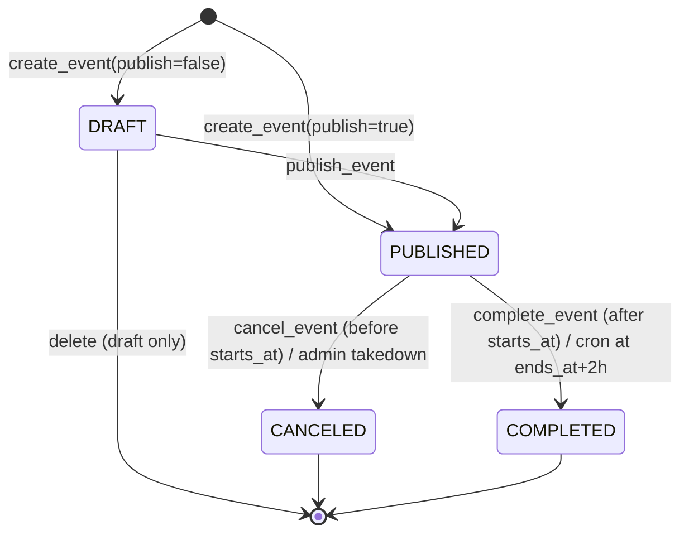
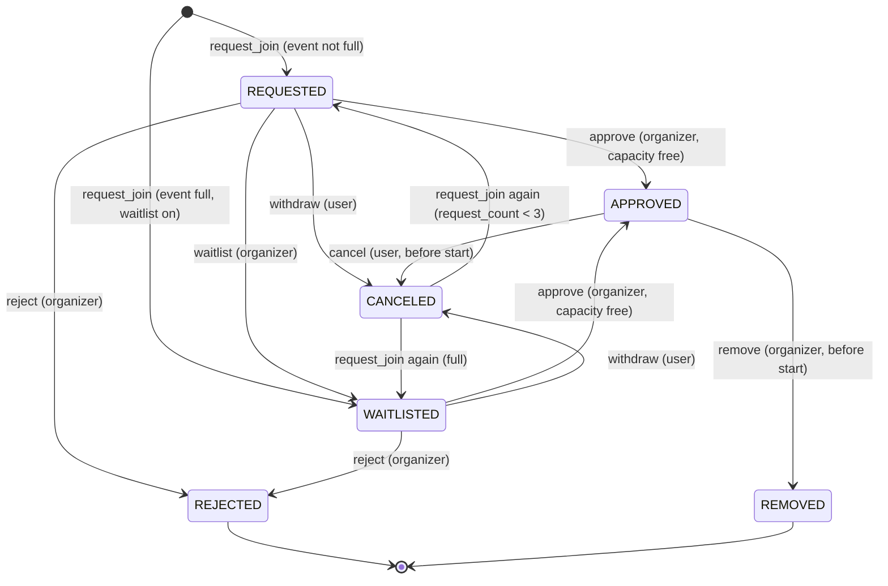
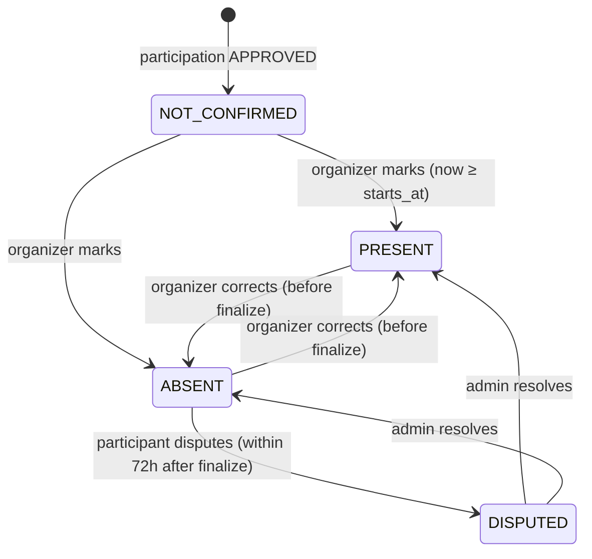

# Database Design

Status: Phase 0 design (no migrations exist yet) · Engine: PostgreSQL (Supabase) + PostGIS

Related: [ARCHITECTURE](ARCHITECTURE.md) · [SECURITY](SECURITY.md) · [RATING_SYSTEM](RATING_SYSTEM.md) · ADR-0003, ADR-0004

## 1. Principles

1. **The database is the authority** for state transitions, capacity and progression. Clients never write core tables directly.
2. **Write path = RPC functions** (`SECURITY DEFINER`, `search_path = ''`, explicit `auth.uid()` checks). Core tables have **no INSERT/UPDATE/DELETE grants or policies** for `anon`/`authenticated`. Only low-risk self-owned tables (e.g. own profile fields) allow direct writes, via column-restricted RPCs.
3. **Read path = RLS-protected selects** plus a few read RPCs (`search_events`, `get_event_by_invite`).
4. **Invariants live in constraints/triggers**, with RPCs as the friendly interface (defense in depth).
5. UUID PKs (`gen_random_uuid()`), `timestamptz` (UTC) everywhere, `text` + `CHECK` or Postgres enums for closed sets that rarely change (enums for lifecycle/state; lookup tables for catalog-like data).
6. PostGIS installed in schema `extensions`, never `public`. Geographic columns use `geography(Point, 4326)`.
7. Tables for append-only facts (XP, reliability, audit) have triggers blocking `UPDATE`/`DELETE` (except documented void markers).
8. Create only what the current phase needs. Future entities are documented in §4 and **not** created.

Naming: snake_case, plural table names, `*_at` timestamps, `*_id` FKs. Schemas: `public` (exposed tables/RPCs), `private` (helpers, never exposed to the Data API), `extensions`.

## 2. Domain concepts (kept distinct)

| Concept | Meaning | Storage |
|---|---|---|
| Sport | Catalog entry (Football) | `sports` |
| Activity format | Configuration of a sport (7v7, doubles) with participant bounds | `sport_formats` |
| Position / role | Optional role within a sport (Goalkeeper, Setter) | `sport_positions` |
| Event | One scheduled activity with an organizer | `events` |
| Event participation | A user's relationship to one event (request → approval → attendance) | `event_participations` |
| Team | Persistent group of users (**future**) | `teams` (future) |
| Event team assignment | Which side a participant plays on (**future**) | future |

An event does **not** require two competing teams; capacity is a single participant count.

## 3. MVP entities (by phase of introduction)

Legend: **PK**, *FK*, `UQ` unique, `CK` check.

### 3.1 Identity (Phase 1–2)

| Table | Purpose | Key columns / constraints |
|---|---|---|
| `profiles` | Public-facing identity; 1:1 with `auth.users` | **id** (= auth user id; **deliberately no FK to `auth.users`** so the tombstone survives auth deletion, see §11 and ADR-0003), `display_name` CK len 2–40, `avatar_path`, `bio` CK ≤ 280, `city_id`, `district_id`, `account_status` enum `ACTIVE/SUSPENDED/PENDING_DELETION/DELETED`, `deletion_requested_at`, `adult_confirmed_at` (NOT NULL once onboarded), `created_at`, `updated_at` |
| `user_settings` | Private preferences & privacy | **user_id**, `locale` (`tr`/`en`), `theme`, `profile_visibility` enum `EVERYONE/EVENT_PEERS` default `EVENT_PEERS`, `show_reliability`, `show_badges`, `marketing_consent_at` (null = no) |
| `user_consents` | Evidence of consent/acceptance | `user_id`, `kind` (`TERMS`, `PRIVACY_NOTICE`, `MARKETING`), `version`, `granted_at`, `revoked_at`; UQ(user_id, kind, version) |
| `user_sport_profiles` | A user's sports | **(user_id, sport_id)**, `self_assessed_level` numeric(2,1) CK 1.0–5.0, `self_assessed_at` |
| `user_sport_positions` | Preferred positions | **(user_id, sport_id, position_id)**, FK position must belong to sport (composite FK) |
| `platform_admins` | Admin role (no client write path) | **user_id**, `granted_by`, `granted_at`, `revoked_at`; written only with service credentials/migrations |

`handle_new_user()` trigger on `auth.users` creates `profiles` + `user_settings` rows (minimal, `account_status = ACTIVE`; onboarding completes the rest). Role/admin status is **never** stored in a user-writable table or in user-editable JWT metadata.

### 3.2 Sports catalog (Phase 2–3)

| Table | Key columns |
|---|---|
| `sports` | **id**, `slug` UQ, `names` jsonb `{tr,en}`, `icon_key`, `is_team_sport`, `is_active`, `skill_descriptors` jsonb (levels 1–5 × locales), `settings` jsonb (validated against a Zod schema in `packages/domain`), `sort_order` |
| `sport_formats` | **id**, *sport_id*, `slug` UQ(sport_id, slug), `names` jsonb, `min_participants`, `default_capacity`, `max_participants`, `is_flexible` bool; CK `min ≤ default ≤ max`, `is_active` |
| `sport_positions` | **id**, *sport_id*, `slug` UQ(sport_id, slug), `names` jsonb, `sort_order` |

Seeded via `supabase/seed/` (idempotent upserts keyed by slug). Catalog edits in MVP are migrations/seed changes (admin catalog UI is post-MVP).

### 3.3 Geography (Phase 3–4)

| Table | Phase | Key columns |
|---|---|---|
| `cities` | 3 | **id**, `slug` UQ, `names` jsonb, `timezone` (IANA), `country_code`, `centroid` geography, `is_active` — Ankara seeded; multi-city ready |
| `districts` | 3 | **id**, *city_id*, `slug` UQ(city_id, slug), `names` jsonb, `centroid` geography |
| `venues` | 4 | **id**, `kind` enum `PUBLIC_SPACE/COMMERCIAL_FACILITY`, `name`, `name_search` (generated via `private.normalize_tr`), *city_id*, *district_id*, `location` geography(Point), `address_text`, `provenance` enum `ADMIN_CURATED/USER_SUBMITTED/OSM_IMPORT/PARTNER_SUBMITTED/LICENSED_DATASET`, `source_ref` (external id), `verification_status` enum `UNVERIFIED/VERIFIED`, `listing_status` enum `ACTIVE/HIDDEN`, `submitted_by`, `created_at` |
| `venue_sports` | 4 | **(venue_id, sport_id)** |

**Provenance and verification are separate columns** (where data came from vs. whether staff confirmed it). `provenance = OSM_IMPORT` rows must stay separable (ODbL share-alike risk, SECURITY §10). No opening hours, prices or availability are stored in MVP; the UI always states that a listing does not imply a booking.

### 3.4 Events (Phase 3)

**`events`**

| Column | Notes |
|---|---|
| `id`, `organizer_id` → `profiles` | organizer = creator (single organizer in MVP) |
| `client_request_id` | UQ(organizer_id, client_request_id): idempotent create |
| `event_type` enum `COMMUNITY/PARTNER` | **CK `event_type = 'COMMUNITY'` in MVP**; relaxed by a later migration |
| `sport_id`, `sport_format_id` | immutable after publish |
| `title` (3–80), `description` (≤ 2000) | |
| `status` enum `DRAFT/PUBLISHED/CANCELED/COMPLETED` | lifecycle only (§5) |
| `visibility` enum `PUBLIC/INVITE_ONLY`; `invite_token` | token required iff `INVITE_ONLY`; UQ; 128-bit random |
| `starts_at`, `duration_minutes` (15–480), `ends_at` (generated stored) | |
| `registration_closes_at` | nullable → defaults to `starts_at` |
| `city_id`, `district_id`, `venue_id` (Phase 4), `location_label` | |
| `public_point` geography(Point) | exact for `PUBLIC`; server-fuzzed (~300–500 m grid snap) for `APPROVED_ONLY` |
| `location_visibility` enum `PUBLIC/APPROVED_ONLY` | |
| `capacity` smallint CK ≥ 2, `approved_count` smallint CK `0 ≤ approved_count ≤ capacity` | `approved_count` is trigger-maintained under the event row lock; never client-writable |
| `waitlist_enabled` bool default true; `organizer_plays` bool default true | |
| `skill_min`, `skill_max` numeric(2,1) | nullable; CK `1.0 ≤ min ≤ max ≤ 5.0` |
| `booking_status` enum `NOT_REQUIRED/NOT_YET_BOOKED/BOOKED_EXTERNALLY/TO_BE_CONFIRMED` | organizer-declared |
| `cost_amount_minor` int ≥ 0, `cost_currency` char(3) default `TRY`, `cost_note` | informational |
| `equipment_note` (≤ 500) | |
| `published_at`, `canceled_at`, `cancel_reason` enum + `cancel_message`, `completed_at`, `attendance_finalized_at`, `review_window_closes_at`, `last_material_change_at`, `created_at`, `updated_at` | CK ties timestamps to status (e.g. `canceled_at IS NOT NULL ⇔ status='CANCELED'`) |

**`event_private_details`** (1:1, readable only by organizer and APPROVED participants — plus admins): `event_id`, `exact_point` (used when `APPROVED_ONLY`), `address_text`, `participant_notes` (≤ 1000; e.g. WhatsApp group link), `access_notes`. Separate table because Postgres RLS cannot mask individual columns per row.

**`event_participations`** — single table for request, waitlist, approval and attendance (no separate "requests" and "waitlist" tables: one row per user per event removes duplicate-state bugs)

| Column | Notes |
|---|---|
| `id`, `event_id`, `user_id` | **UQ(event_id, user_id)** — prevents duplicate participation |
| `status` enum `REQUESTED/APPROVED/REJECTED/WAITLISTED/CANCELED/REMOVED` | participation lifecycle (§6) |
| `attendance` enum `NOT_CONFIRMED/PRESENT/ABSENT/DISPUTED` default `NOT_CONFIRMED` | independent of `status`; **CK `attendance <> 'NOT_CONFIRMED' ⇒ status = 'APPROVED'`** |
| `request_message` (≤ 280), `preferred_position_id` | informational |
| `request_count` smallint CK ≤ 3 | re-request limiter |
| `requested_at`, `waitlisted_at` (FIFO order), `decided_at`, `decided_by`, `approved_at`, `canceled_at`, `cancellation_excused` bool, `status_reason` | |
| `attendance_marked_at`, `attendance_marked_by` | |

**`attendance_disputes`**: `participation_id` UQ, `reason`, `status` `OPEN/RESOLVED`, `resolution` `PRESENT/ABSENT`, `resolved_by`, `resolved_at`, `created_at`.

**Indexes (events):** partial `(city_id, starts_at, id) WHERE status='PUBLISHED' AND visibility='PUBLIC'` (discovery default); GiST on `public_point` (partial on published/public); `(sport_id, starts_at) WHERE status='PUBLISHED'`; `(organizer_id, starts_at DESC)`; `(status, ends_at)` for the cron sweep. **Indexes (participations):** UQ above; `(user_id, status, event_id)` for My Events; `(event_id, status, waitlisted_at)` for organizer queues/waitlist FIFO.

### 3.5 Progression (Phase 5)

| Table | Purpose | Notes |
|---|---|---|
| `skill_reviews` | Peer skill review | **id**, `event_id`, `reviewer_id`, `reviewee_id`, `sport_id`, `skill_score` smallint CK 1–5, `fair_play` bool, `status` `ACTIVE/HIDDEN`, `created_at`; **UQ(event_id, reviewer_id, reviewee_id)**; CK reviewer ≠ reviewee. Readable **only** by the reviewer (double-blind, anonymous aggregate) |
| `user_sport_ratings` | Derived snapshot per user per sport | **(user_id, sport_id)**, `rating` numeric(2,1), `confidence` numeric, `sample_events` int, `algorithm_version` int, `computed_at` — recomputed, never edited |
| `reliability_events` | Append-only reliability signals | `user_id`, `participation_id`, `kind` `ATTENDED/LATE_CANCEL/NO_SHOW`, `weight`, `occurred_at`, `voided_at`, `void_reason`; UQ(participation_id); only `voided_at/void_reason` may change |
| `user_progress` | Derived cache | **user_id**, `reliability_score`, `reliability_samples`, `reliability_confidence`, `xp_total`, `algorithm_version`, `computed_at` — level is derived in code from `xp_total` (formula centralized in `packages/domain`) |
| `xp_transactions` | **Immutable XP ledger** | `id`, `user_id`, `amount` int ≠ 0, `reason_code`, `source_type`, `source_id`, `rule_version`, **`dedupe_key` UQ NOT NULL**, `created_at`. No UPDATE/DELETE (trigger). Corrections are compensating negative rows |
| `achievement_definitions` | Badge catalog | `code` PK, `names/descriptions` jsonb, `rule` jsonb (type + params), `scope` `GLOBAL/PER_SPORT`, `xp_bonus`, `is_active`, `version` |
| `user_achievements` | Awards | `user_id`, `code`, `sport_id` (nullable for GLOBAL), `awarded_at`, `source_event_id`, `revoked_at`; UQ(user_id, code, coalesce(sport_id, zero-uuid)) |

### 3.6 Communication, trust, operations (Phase 3 basic → 6)

| Table | Purpose | Notes |
|---|---|---|
| `notifications` | In-app inbox + future outbox | `id`, `user_id`, `type`, `payload` jsonb (ids only — no PII), `dedupe_key` UQ, `read_at`, `created_at`. Inserted inside the same transaction as the triggering change |
| `reports` | User reports | `reporter_id`, `target_type` `USER/EVENT/VENUE/REVIEW`, `target_id`, `reason` enum, `details` ≤ 1000, `status` `OPEN/ACTIONED/DISMISSED`, `handled_by`, `handled_at`; UQ per (reporter, target) while OPEN |
| `user_blocks` | Blocking | **(blocker_id, blocked_id)**, CK ≠ |
| `moderation_actions` | Admin decisions | `admin_id`, `action` enum, `target_type/id`, `report_id`, `reason`, `created_at` — append-only |
| `audit_logs` | Security-relevant events | `actor_id`, `action`, `target`, `metadata` jsonb (no secrets/PII), `created_at` — append-only, no IP stored in MVP |
| `rate_limit_counters` | Per-user action quotas | `(user_id, action, window_start)`, `count`; pruned by cron |
| `analytics_events` | First-party product analytics | `name` (allowlisted), `user_id` (SET NULL on anonymization), `props` jsonb (allowlisted keys), `platform`, `app_version`, `created_at`; retention 13 months. Server-side events are emitted by RPCs via `private.emit_event()` **from Phase 3** (so the table ships with the first event RPCs); the client-facing `track_event` RPC and dashboards come in Phase 7 |
| `app_config` | Operational switches (kill switches for create/join, `min_supported_app_version`, quota overrides) | `key` PK, `value` jsonb, `updated_at`; readable by authenticated, written only with service credentials; introduced in Phase 1 |

**Rule:** `notifications.payload` carries identifiers and template keys, not names or free text; the client resolves display data under normal RLS so blocked/deleted users do not leak through stored notification text.

## 4. Future entities (documented, **not created** in MVP)

| Domain | Entities | Trigger to build |
|---|---|---|
| Community | `teams`, `team_members`, `team_invitations`, `user_connections`, `event_messages` | Post-MVP community phase |
| Event extensions | `event_team_assignments`, `event_position_needs` (enforced slots), recurring series (`event_series`) | Teams / recurring (P-04, P-05, P-13) |
| Venues | `venue_spaces` (courts/pitches), `venue_verifications`, `venue_submissions` (queue, if moderation volume warrants), availability calendars | Venue operator phase |
| Commercial | `organizations`, `organization_members`, `partner_verifications`, `booking_requests`, `reservations`, `payment_records`, `sponsorship_placements` | Partner / payments phases (P-08…P-11); `events.organization_id` and relaxing the `COMMUNITY` check ship with them |
| Notifications | `notification_preferences`, `device_tokens`, `notification_deliveries` | Push (P-01) |
| Safety | `appeals` | Moderation maturity |

Design seams already in MVP: `event_type`, `venues.provenance/verification_status`, `notifications` as outbox, `platform_admins` pattern for later `organization_members`, `xp_transactions.source_type`, `booking_status` (organizer-declared) distinct from future `reservations`.

## 5. MVP ER model

```mermaid
erDiagram
  AUTH_USERS ||--|| PROFILES : "id"
  PROFILES ||--|| USER_SETTINGS : has
  PROFILES ||--o{ USER_CONSENTS : accepts
  PROFILES ||--o{ USER_SPORT_PROFILES : plays
  SPORTS ||--o{ USER_SPORT_PROFILES : "for"
  SPORTS ||--o{ SPORT_FORMATS : defines
  SPORTS ||--o{ SPORT_POSITIONS : defines
  USER_SPORT_PROFILES ||--o{ USER_SPORT_POSITIONS : prefers
  SPORT_POSITIONS ||--o{ USER_SPORT_POSITIONS : "is"
  CITIES ||--o{ DISTRICTS : contains
  CITIES ||--o{ VENUES : "located in"
  VENUES ||--o{ VENUE_SPORTS : supports
  SPORTS ||--o{ VENUE_SPORTS : "for"
  PROFILES ||--o{ EVENTS : organizes
  SPORTS ||--o{ EVENTS : "of"
  SPORT_FORMATS ||--o{ EVENTS : "uses"
  CITIES ||--o{ EVENTS : "in"
  VENUES |o--o{ EVENTS : "optionally at"
  EVENTS ||--o| EVENT_PRIVATE_DETAILS : has
  EVENTS ||--o{ EVENT_PARTICIPATIONS : has
  PROFILES ||--o{ EVENT_PARTICIPATIONS : "participates"
  EVENT_PARTICIPATIONS ||--o| ATTENDANCE_DISPUTES : "may have"
  EVENTS ||--o{ SKILL_REVIEWS : "context of"
  PROFILES ||--o{ SKILL_REVIEWS : "writes/receives"
  PROFILES ||--o{ USER_SPORT_RATINGS : "derived"
  EVENT_PARTICIPATIONS ||--o| RELIABILITY_EVENTS : "yields"
  PROFILES ||--|| USER_PROGRESS : "derived"
  PROFILES ||--o{ XP_TRANSACTIONS : earns
  ACHIEVEMENT_DEFINITIONS ||--o{ USER_ACHIEVEMENTS : "awarded as"
  PROFILES ||--o{ USER_ACHIEVEMENTS : unlocks
  PROFILES ||--o{ NOTIFICATIONS : receives
  PROFILES ||--o{ REPORTS : files
  PROFILES ||--o{ USER_BLOCKS : blocks
  PROFILES ||--o{ MODERATION_ACTIONS : "admin performs"
  PROFILES ||--o| PLATFORM_ADMINS : "may be"
```



Implemented-in-phase map: Phase 1 `profiles, user_settings, user_consents, platform_admins`; Phase 2 `sports*, user_sport_*`; Phase 3 `cities, districts, events, event_private_details, event_participations, notifications`; Phase 4 `venues, venue_sports`; Phase 5 `attendance_disputes, skill_reviews, user_sport_ratings, reliability_events, user_progress, xp_transactions, achievement_*, user_achievements`; Phase 6 `reports, user_blocks, moderation_actions, audit_logs`; `app_config` Phase 1; `rate_limit_counters, analytics_events` Phase 3 (first quota-bearing and event-emitting RPCs).

## 6. State machines

### 6.1 Event lifecycle (`events.status`)



| From → To | Actor | Guards |
|---|---|---|
| DRAFT → PUBLISHED | organizer | `starts_at ≥ now()+60min`; required fields valid; quota not exceeded; account ACTIVE & email verified |
| PUBLISHED → CANCELED | organizer (admin override) | `now() < starts_at`; reason required; no participant penalties |
| PUBLISHED → COMPLETED | organizer or system | `now() ≥ starts_at` (organizer) / `now() ≥ ends_at + 2h` (cron) |

Everything else is rejected. `CANCELED` and `COMPLETED` are terminal. **Not states** (derived): *full* (`approved_count = capacity`), *registration closed* (`now() ≥ coalesce(registration_closes_at, starts_at)`), *started* (`now() ≥ starts_at`), *attendance finalized* (`attendance_finalized_at IS NOT NULL`), *review window open* (`now() < review_window_closes_at`).

Join eligibility is therefore: `status = PUBLISHED ∧ now() < registration_close ∧ user ≠ organizer ∧ no block ∧ ACTIVE user`.

### 6.2 Participation (`event_participations.status`)



| Transition | Actor | Guards / effects |
|---|---|---|
| none → REQUESTED / WAITLISTED | user | event join-eligible; `approved_count < capacity` ⇒ REQUESTED else WAITLISTED (if `waitlist_enabled`, else `EVENT_FULL`); sets `waitlisted_at` for FIFO; notify organizer |
| REQUESTED/WAITLISTED → APPROVED | organizer | **locks event row**; `approved_count < capacity` else `EVENT_FULL`; increments `approved_count`; sets `approved_at`; notify user |
| → REJECTED | organizer | terminal; notify user |
| REQUESTED → WAITLISTED | organizer | `waitlist_enabled`; notify user |
| → CANCELED (from REQUESTED/WAITLISTED) | user | no reliability effect |
| APPROVED → CANCELED | user | `now() < starts_at`; decrements `approved_count`; stores `cancellation_excused` if within 24 h of a material change; opens a slot → notify organizer ("spot opened, N waitlisted") — **no auto-promotion** |
| APPROVED → REMOVED | organizer | `now() < starts_at`; decrements `approved_count`; reason; notify user; neutral for reliability |
| CANCELED → REQUESTED/WAITLISTED | user | `request_count < 3`; same eligibility as new request |

Event cancel/complete does **not** mass-rewrite participation rows; participation statuses are interpreted in context of the event status (no cascade writes, no race with cancellations).

### 6.3 Attendance (`event_participations.attendance`)



- Marking allowed while event is `PUBLISHED` (after start) or `COMPLETED`, and not finalized. Finalization (`attendance_finalized_at`) happens by organizer action or by cron at `completed_at + 48h`; it freezes marks, creates reliability events, awards XP, evaluates achievements and sets `review_window_closes_at = finalized_at + 72h`.
- Auto-finalization leaves `NOT_CONFIRMED` rows untouched: **neutral** (no XP, no penalty, no review rights). This protects players from organizer neglect (limitation in RATING_SYSTEM §9).
- The organizer's own row (when `organizer_plays`) is **PRESENT by default** and cannot be disputed. Because it is self-attested, it **never produces reliability events**; XP/badge credit for it is conditional on the event having ≥ 2 verified-present non-organizer participants (RATING_SYSTEM §2, §4.1, §5.2).
- `DISPUTED` is excluded from all scoring until resolved; resolution voids/creates reliability events and XP through compensating rows.

## 7. Invariants (each needs a test — see TESTING)

| ID | Invariant | Enforced by |
|---|---|---|
| I-1 | `approved_count` = count of `APPROVED` rows and `≤ capacity` at all times | row lock + constraint trigger + CK; consistency test query |
| I-2 | One participation row per (event, user) | UQ |
| I-3 | Only listed transitions occur; actor and guards respected | RPCs + `BEFORE UPDATE` trigger rejecting illegal `OLD→NEW` pairs |
| I-4 | Non-`APPROVED` rows have `attendance = NOT_CONFIRMED` | CK |
| I-5 | Organizer cannot request to join own event (organizer row is created at publish if `organizer_plays`) | RPC + trigger |
| I-6 | Capacity cannot drop below `approved_count` | RPC + CK |
| I-7 | Sport, format and `organizer_plays` immutable after publish; COMPLETED/CANCELED events immutable; the organizer's own participation row cannot be canceled/removed through participant RPCs | trigger + RPC |
| I-8 | Reviews only between PRESENT participants of the same finalized event, inside the window, one per ordered pair, not self | RPC + trigger + UQ |
| I-9 | XP rows are immutable and deduplicated by `dedupe_key` | trigger + UQ |
| I-10 | Reliability events: ≤ 1 per participation; derived only from finalized events | UQ + RPC |
| I-11 | `event_type = COMMUNITY` in MVP | CK |
| I-12 | Blocked pairs cannot request, review, or see each other's events | RPC + RLS |
| I-13 | Client roles cannot write core tables; admin status only via `platform_admins` | no grants/policies; test |
| I-14 | `INVITE_ONLY` events have a token; `PUBLIC` events do not need one | CK |

## 8. Concurrency design

Capacity-changing operations (`approve_participation`, `request_join` when it must decide REQUESTED vs WAITLISTED, `cancel_participation`, `remove_participant`, `update_event` capacity) all run as:

```sql
-- inside a SECURITY DEFINER function, one transaction (READ COMMITTED is sufficient with the lock)
SELECT ... FROM public.events WHERE id = p_event_id FOR UPDATE;   -- serializes per event
-- authorize, validate state, re-read approved_count
UPDATE public.event_participations SET status = 'APPROVED', ... WHERE id = p_id AND status IN ('REQUESTED','WAITLISTED');
-- constraint trigger recomputes under the same lock; raises EVENT_FULL if approved_count would exceed capacity
INSERT INTO public.notifications ... ON CONFLICT (dedupe_key) DO NOTHING;
```

- Lock scope: one event row. Contention is per-event and short; no global locks.
- Idempotency: re-approving an already `APPROVED` row returns success without side effects; notifications use `dedupe_key = '<type>:<participation_id>:<status_version>'`.
- Safety net: a `BEFORE INSERT OR UPDATE OF status` trigger on `event_participations` takes the same event-row lock and verifies capacity, so even a buggy future code path cannot exceed capacity.
- `create_event` is idempotent via `client_request_id`.
- Tests (mandatory, ROADMAP/TESTING): N parallel connections approving distinct requests for the last slot; parallel `request_join` + `approve`; cancel/approve interleavings; assert `approved_count ≤ capacity` and no lost updates. Run against real Postgres (local Supabase), not mocks.

## 9. RPC catalogue (public API surface)

All RPCs: `SECURITY DEFINER`, `SET search_path = ''`, `REVOKE ALL FROM PUBLIC, anon`, `GRANT EXECUTE TO authenticated` (**the only exceptions are the explicitly listed guest-readable read RPCs `search_events`/`get_event`, which additionally grant to `anon` and are covered by dedicated tests**) (admin RPCs additionally check `private.is_admin()` + AAL2). Errors are raised as `P0001` with a stable code in `MESSAGE` (mapped to `DomainErrorCode` in `packages/domain`): `NOT_AUTHENTICATED, NOT_ALLOWED, ACCOUNT_RESTRICTED, EMAIL_NOT_VERIFIED, NOT_FOUND, VALIDATION_FAILED, INVALID_TRANSITION, EVENT_FULL, REGISTRATION_CLOSED, ALREADY_REQUESTED, REQUEST_LIMIT_REACHED, BLOCKED, RATE_LIMITED, REVIEW_NOT_ELIGIBLE, ALREADY_REVIEWED, WINDOW_CLOSED`.

| RPC | Phase | Caller | Notes |
|---|---|---|---|
| `complete_onboarding(...)` | 2 | self | sets adult confirmation, consents, city, sport profiles in one transaction |
| `update_my_profile(...)`, `update_my_settings(...)` | 2 | self | column-restricted |
| `create_event(...)`, `update_event(...)`, `publish_event(id)`, `cancel_event(id, reason)`, `complete_event(id)`, `delete_draft(id)` | 3 | organizer | |
| `search_events(filters, cursor)` | 3 (geo 4) | **`anon` + authenticated** (guest discovery, D-09) | PostGIS; masked location for `APPROVED_ONLY`; excludes blocked pairs when signed in; keyset pagination; hard page-size cap (≤ 50) and `statement_timeout`; returns only public event fields |
| `get_event(id)` | 3 | **`anon` + authenticated** | public events only for guests; viewer-specific fields (own participation, private details) only when authorized |
| `get_event_by_invite(token)` | 3 | authenticated | |
| `request_join(event_id, message, position_id)`, `cancel_participation(event_id)` | 3 | participant | |
| `approve_participation(id)`, `reject_participation(id)`, `waitlist_participation(id)`, `remove_participant(id, reason)` | 3 | organizer | |
| `list_my_events(bucket, cursor)`, `list_event_requests(event_id)` | 3 | self / organizer | |
| `mark_attendance(participation_id, value)`, `finalize_attendance(event_id)`, `dispute_attendance(participation_id, reason)` | 5 | organizer / participant | |
| `submit_reviews(event_id, reviews[])` | 5 | participant | validates eligibility for each pair atomically |
| `mark_notifications_read(ids)` | 3 | self | |
| `report(target_type, target_id, reason, details)`, `block_user(id)`, `unblock_user(id)` | 6 | self | |
| `admin_*` (queue, action, resolve dispute, verify venue, suspend) | 6 | admin | audited |
| `request_account_deletion()`, `cancel_account_deletion()` | 6 | self | actual purge by Edge Function after grace |
| `track_event(name, props)` | 7 | self | allowlist, rate limited |

**System jobs (pg_cron → SQL functions, no Edge hop):** `complete_due_events` (every 10 min), `auto_finalize_attendance` (every 15 min), `close_review_windows` (recompute ratings, every 15 min), `purge_rate_limit_counters` (daily), `process_deletion_queue` (daily; invokes Edge Function for auth deletion), `prune_analytics` (weekly).

## 10. Row Level Security matrix (summary)

RLS is **enabled on every table** (CI check fails on any table without it). Helper predicates live in `private` (`is_admin()`, `is_event_organizer(event_id)`, `is_approved_participant(event_id)`, `is_blocked_pair(a, b)`), `STABLE SECURITY DEFINER`, with `search_path = ''`.

| Table | SELECT | Direct writes |
|---|---|---|
| `profiles` | self; others per `profile_visibility` + not blocked; organizers of events where the profile has a pending/waitlisted request (game-relevant fields only, via RPC/view); admin | none (RPC) |
| `user_settings`, `user_consents` | self only | none (RPC) |
| `user_sport_profiles/positions` | self; others visible when the profile is visible | none (RPC) |
| `platform_admins` | admin only | none (service role only) |
| `sports`, `sport_formats`, `sport_positions`, `cities`, `districts` | **`anon` and `authenticated`** (active rows; needed for guest discovery) | none |
| `events` | **`anon`/`authenticated`: `PUBLISHED ∧ PUBLIC`** (location already masked per `location_visibility`; no private columns exist on this table); organizer, participant (any status) and admin additionally see their own non-public rows; blocked pairs excluded for signed-in viewers; `INVITE_ONLY` via RPC only | none (RPC) |
| `event_private_details` | organizer; `APPROVED` participants; admin | none (RPC) |
| `event_participations` | own row; organizer of the event; `APPROVED` participants see other `APPROVED` rows' minimal fields via RPC; admin | none (RPC) |
| `skill_reviews` | reviewer sees own; nobody else (aggregates via ratings) | none (RPC) |
| `user_sport_ratings`, `user_progress` | self; others if profile visible and flag allows; admin | none (system) |
| `reliability_events`, `xp_transactions` | self; admin | none (system) |
| `user_achievements` | self; others if visible and `show_badges`; admin | none (system) |
| `notifications` | self | `read_at` via RPC only |
| `reports` | reporter (own); admin | none (RPC) |
| `user_blocks` | blocker (own) | none (RPC) |
| `moderation_actions`, `audit_logs` | admin | none |
| `rate_limit_counters`, `analytics_events` | none (service / RPC only) | none |

Realtime: only `notifications` (own rows) and `events.approved_count` for the open event screen. Postgres Changes honors RLS; subscription channels are created per screen and torn down on blur.

## 11. Data lifecycle, retention, deletion/anonymization

Retention numbers are **proposals pending legal review** (SECURITY §8).

| Data | Retention |
|---|---|
| Active account data | While account active |
| Notifications | 90 days after read; 180 days max |
| Analytics events | 13 months, then deleted |
| Rate-limit counters | 7 days |
| Audit logs / moderation actions | 2 years (security & legal defense), then purged |
| Reports | 2 years after resolution |
| Participation / attendance / event history | Retained (needed for other users' history and ratings); personal link removed at anonymization |
| Reviews written by a deleted user | Retained anonymously (they were already anonymous to reviewees; aggregate integrity) |
| Reviews about a deleted user | Deleted |
| XP/reliability/ratings of a deleted user | Deleted |

**Deletion flow.** `request_account_deletion` → status `PENDING_DELETION` (profile hidden, new activity blocked, future organized events canceled with notification, pending/approved participations canceled with "excused" flag) → 30-day grace, cancellable → `process_deletion_queue`: Edge Function (service role) deletes `auth.users` row, then SQL anonymization: `profiles` row kept as tombstone (`display_name = NULL`, shown as "Deleted user"/"Silinmiş kullanıcı"; avatar, bio, district cleared; `account_status = DELETED`), `user_settings`/`user_consents`(keep acceptance evidence minimal: version + timestamp, user reference removed after statutory period — legal to confirm)/sport profiles/ratings/progress/XP/achievements deleted; `analytics_events.user_id` nulled; storage objects removed. The tombstone keeps FK integrity for historical events and other users' aggregates. Because `profiles.id` has **no FK to `auth.users`** (decision in ADR-0003), deleting the auth user does not cascade into or block on application data. Integrity in the other direction is maintained by the `handle_new_user` trigger and a daily reconciliation query (every non-`DELETED` profile must have an auth user; alert otherwise). RLS stays simple (`auth.uid() = profiles.id`). Re-registration with the same email creates a **new** profile id; nothing is re-linked.

**Export.** `export_my_data` Edge Function assembles JSON (profile, settings, sport profiles, participations, own reviews, XP ledger, achievements, notifications, reports filed) and delivers via short-lived signed URL; rate-limited to 1/day.

## 12. Migrations, seeds, tooling

- Supabase CLI migrations in `supabase/migrations/` (timestamped, forward-only; never edit applied files). Each migration is reviewed for locks (use `CREATE INDEX CONCURRENTLY` where tables are large, `NOT VALID` + `VALIDATE` for constraints on populated tables).
- Seeds: `supabase/seed/` — reference data (sports, formats, positions, cities, districts, achievements) idempotent and safe in production; `dev/` fixtures (fake users/events) only for local/staging, never deployed to production.
- Types: `supabase gen types typescript` output committed and checked in CI for drift.
- Tests: pgTAP for schema/RLS (`supabase test db`) plus Vitest integration tests with multiple real connections for concurrency (TESTING).
- Destructive operations (drop/truncate, data backfill) require explicit description in the PR and a rollback/restore plan (CLAUDE.md rule 19).
- Turkish text search: `unaccent` + `pg_trgm` with `private.normalize_tr(text)` (maps `İ,I,ı,i → i`, strips diacritics, lowercases deterministically, **not** dependent on DB locale).
