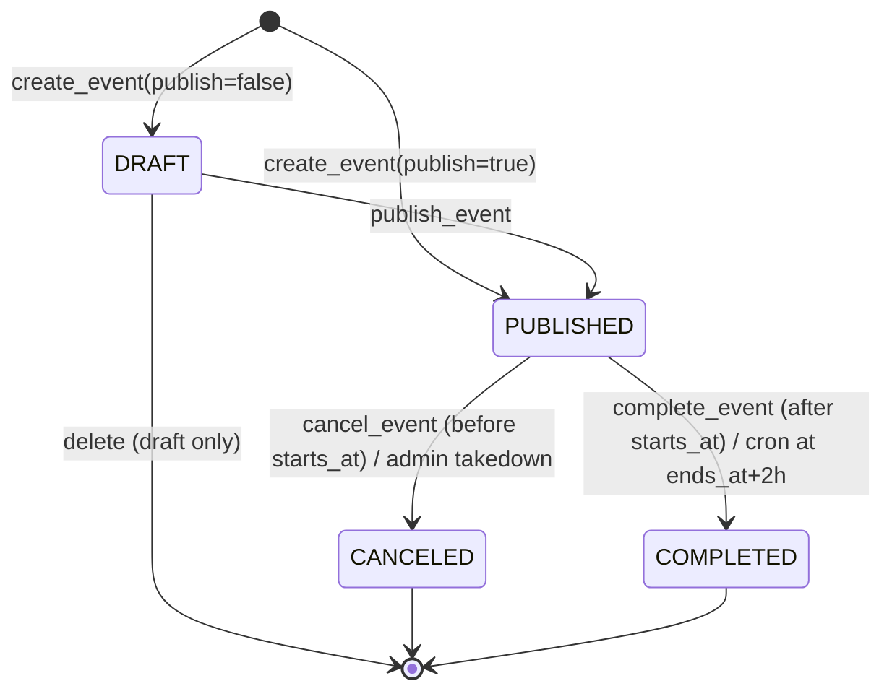
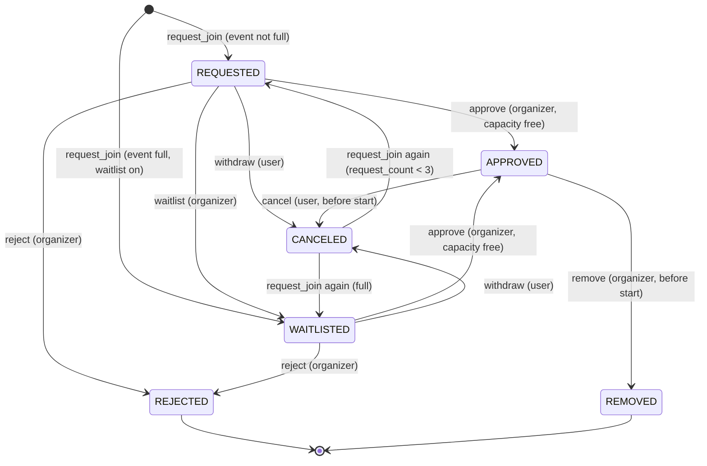
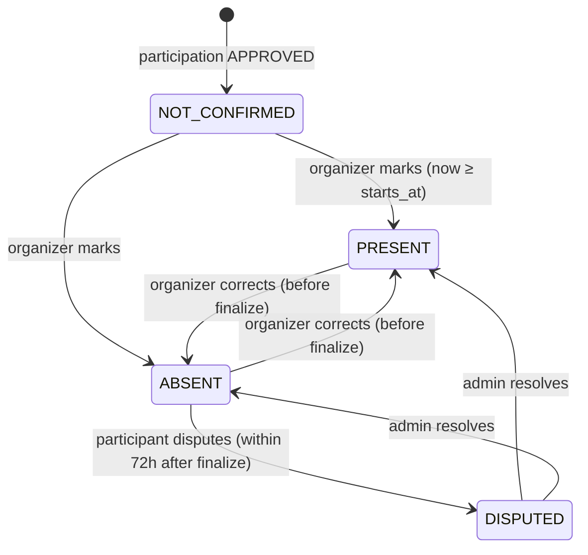

# Database Design

Status: Phase 0 design (no migrations exist yet) · Engine: PostgreSQL (Supabase) + PostGIS

Related: [ARCHITECTURE](ARCHITECTURE.md) · [SECURITY](SECURITY.md) · [RATING_SYSTEM](RATING_SYSTEM.md) · ADR-0003, ADR-0004

## 0. As built at the end of Phase 1

Migration `20261024220000_foundation_identity.sql` implements §3.1 partially: `profiles`, `user_settings`, `user_consents`, `platform_admins`, `app_config`; enums `account_status`, `profile_visibility`, `consent_kind`; `private.set_updated_at`, `private.is_admin`, `private.assert_active_verified_user`, `private.handle_new_user` (trigger on `auth.users`); RPC `public.get_my_account`. Default privileges are revoked so every grant is explicit; **no table has any write grant or policy for API roles**; the only guest-readable object is `app_config`. Not yet created: sport/geo/event/progression/safety tables, PostGIS, `user_sport_profiles`/positions, rate-limit and analytics tables (Phases 2–7). The profile row has no FK to `auth.users` (ADR-0003). pgTAP tests assert all of the above (`supabase/tests/database`).

## 0. As built in Phase 7

- `20261109100000_dispute_admin_guard.sql` (M2): `admin_resolve_attendance_dispute` uses `private.assert_admin_aal2`.
- `20261126100000_business_staff.sql` (Phase 10 M4, ADR-0031):
  - **Members:** `business_members.status` `ACTIVE`/`INVITED` and `invited_by`; a waiting row is always `STAFF`; at most 20 staff (`quota.max_business_staff`).
  - **RPCs:** `invite_business_staff` (owner; blocked pairs refused), `respond_business_invite`, `remove_business_staff` (owner), `leave_business` (staff; the owner cannot leave), `list_businesses_to_invite` (player card). `update_business_venue` is open to active staff; `get_my_business` opens to staff without the contact details or the staff list; `list_my_businesses` returns `membership`.
  - **Notification:** `BUSINESS_STAFF_INVITED`.
- `20261129100000_event_series_app.sql` (Phase 11 M2, ADR-0032): additive fields for the app. `list_my_events` rows carry `in_series`; `get_event_series` adds `weekday` (ISO, 1 = Monday) and `local_time` (`HH:MM`) of an active series, in Europe/Istanbul, taken from the next start not yet opened (the series' own schedule, not the event's, which may have been moved by hand).
- `20261128100000_event_series.sql` (Phase 11 M1, ADR-0032, ROADMAP P-05):
  - **Table:** `event_series` (organizer, `interval_weeks` 1 or 2, a copy of the event's details as event input in `template`, `close_offset`, `anchor_at`, `next_at`, `ACTIVE`/`STOPPED` with `stopped_reason` `BY_ORGANIZER`/`ORGANIZER_UNAVAILABLE`/`DETAILS_INVALID`). RLS on, no grants. A purge clears `organizer_id` (FK to `auth.users`, set null) and a trigger wipes the details; the row stays, because deleting it would touch frozen events (I-7).
  - **Events:** `events.series_id`, unique with `starts_at` (a week is opened once, a canceled week stays canceled).
  - **RPCs:** `create_event_series(event, interval_weeks)` (organizer of a published, upcoming event; at most 2 active, `quota.max_active_series`; repeat calls return the active series), `stop_event_series`, `get_event_series` (anyone who sees the event; next start and stop reason for the organizer), `list_my_event_series`. `create_event` is unchanged in behavior; its insert moved into `private.insert_event`, shared with the job.
  - **Job:** `open-series-events` hourly (`private.open_series_events`): each active series, locked with `skip locked`, opens every week within `series.horizon_days` (14) as a published event, acting as the organizer only while `private.can_organize` holds; a full upcoming-events limit skips the week; invalid details stop the series.
- `20261127100000_admin_dashboard.sql` (ROADMAP P-23, built 2026-11-13): read-only `admin_dashboard_summary()` guarded by `private.assert_admin_aal2`; counts and oldest timestamps for open reports (with target-type counts), pending organizations/businesses, new feedback and open attendance disputes; counts the existing `admin_list_flags()` result; last ten moderation actions without actor or target identifiers. Adds partial open-dispute and moderation timestamp indexes; the other queue filters use existing indexes.
- `20261124100000_business_operator.sql` (Phase 10 M3, ADR-0031; founder 2026-11-12: a business edits itself once approved or added):
  - **RPCs:** `get_my_business` (the owner's view with contact details and venues), `update_my_business` (name and contact, a contact still required), `update_business_venue` (name 3–80 with the display-name filter, address ≤ 300 without links, 1–10 active sports). Only the `OWNER` of an `ACTIVE` business, for its listed venues; never location, province, district, kind or verification.
- `20261123100000_business_admin.sql` (Phase 10 M2, ADR-0031):
  - **Status `HIDDEN`:** set and lifted by an administrator (`admin_set_business_hidden`, note required, moderation actions `BUSINESS_HIDDEN`/`BUSINESS_RESTORED`, target type `BUSINESS`).
  - **`admin_create_business(name, city, owner, venues)`** (P-19): an active business for an onboarded owner, at once; audited `BUSINESS_ADDED`; the owner is notified (`BUSINESS_APPROVED`).
  - **`get_venue_business(venue)`:** the active business running a venue, for anyone signed in. `admin_list_business_requests` also lists `HIDDEN`.
- `20261122100000_businesses.sql` (Phase 10 M1, ADR-0031):
  - **Tables:** `businesses` (name 2–80 with the display-name filter, province, contact phone and/or e-mail for administrators only, a message, status `PENDING`/`ACTIVE`/`REJECTED`/`DISSOLVED`, who decided and why), `business_members` (`OWNER`, later `STAFF`), `business_venues` (one business per venue, `COMMERCIAL_FACILITY` only). RLS on, no API grants.
  - **RPCs:** `request_business` (at most 3 owned, waiting included; at most 10 venues; `VENUE_CLAIMED` when a venue already has or awaits a business), `cancel_business_request`, `list_my_businesses` (without contact details); `admin_list_business_requests`, `admin_decide_business` (second factor; a reason is required to reject; a rejection releases the claims; audited as `BUSINESS_APPROVED`/`BUSINESS_REJECTED`). Ownership never changes a venue's verification.
  - **Notifications:** `BUSINESS_APPROVED`, `BUSINESS_REJECTED`. New error code `VENUE_CLAIMED`.
  - **Export and purge:** `private.export_business_data`; the purge deletes waiting requests, dissolves a business the person owned alone and releases its venues, erases contact details.
- `20261121100000_organization_safety.sql` (Phase 9 M4, ADR-0030):
  - **Status `HIDDEN`:** set by an administrator; like a dissolved organization everywhere else (every read and write requires `ACTIVE`), nothing deleted; restorable.
  - **Reports:** target type `ORGANIZATION` (`report`, `report_item`, `admin_get_report` redefined; not by the owner).
  - **Console:** `admin_get_organization` (members, open reports, history), `admin_set_organization_hidden(id, hidden, note)` (second factor, note required, moderation actions `ORGANIZATION_HIDDEN`/`ORGANIZATION_RESTORED`); `admin_list_organization_requests` also lists `HIDDEN`.
- `20261120100000_organization_events.sql` (Phase 9 M3, ADR-0030):
  - **Events:** `events.organization_id` (the DATABASE §4 seam), indexed with `starts_at`. `event_type` stays `COMMUNITY`.
  - **RPCs:** `set_event_organization(event, org default null)` (the organizer, while draft or published, for an active organization they own or administer; null unlinks), `get_event_organization` (for whoever can see the event; active organizations only), `list_organization_events` (upcoming public published events, at most 50, blocked pairs left out).
- `20261119100000_organization_membership.sql` (Phase 9 M2, ADR-0030):
  - **Members:** `organization_members.status` `ACTIVE`/`INVITED`/`REQUESTED` and `invited_by`; a waiting row is always a plain `MEMBER`; only active rows count or carry authority.
  - **RPCs:** `get_organization` (anyone signed in; members see members, owner and administrators the waiting list; blocked pairs left out), `invite_to_organization` (owner/admin; meets a request), `request_to_join_organization` (meets an invitation), `respond_to_organization_invite`, `decide_organization_request`, `leave_organization` (not the owner), `remove_organization_member` (owner anyone, admin plain members), `set_organization_role` and `transfer_organization_ownership` (owner), `list_organizations_to_invite` (player card).
  - **Notifications:** `ORGANIZATION_INVITED`, `ORGANIZATION_JOIN_REQUESTED`, `ORGANIZATION_MEMBER_APPROVED`. Quotas: 50 open invitations per organization, 20 open requests per person.
- `20261118100000_organizations.sql` (Phase 9 M1, ADR-0030):
  - **Tables:** `organizations` (name 2–40 with the display-name filter, description ≤ 500 without links or numbers, province, 1–5 sports, status `PENDING`/`ACTIVE`/`REJECTED`/`DISSOLVED`, who decided, the reason of a rejection) and `organization_members` (role `OWNER`/`ADMIN`/`MEMBER`, one owner). RLS on, no API grants.
  - **RPCs:** `request_organization` (at most `quota.max_owned_organizations` = 2 owned, waiting ones included), `cancel_organization_request`, `list_my_organizations`; `admin_list_organization_requests`, `admin_decide_organization` (second factor; a reason is required to reject; audited as `ORGANIZATION_APPROVED`/`ORGANIZATION_REJECTED` without text).
  - **Notifications:** `ORGANIZATION_APPROVED`, `ORGANIZATION_REJECTED` to the requester.
  - **Export and purge:** `private.export_organization_data` joins `export_my_data`. The purge deletes waiting requests and memberships; an active organization passes to its longest-standing administrator, or is dissolved without one; rejected ones stay as records.
- `20261117100000_feedback.sql` (ROADMAP P-22):
  - **Table:** `feedback` (kind, body 10–2000, optional screen name, status `NEW`/`SEEN`/`DONE`, who handled it). RLS on, no API grants.
  - **RPCs:** `submit_feedback`; `admin_list_feedback`, `admin_set_feedback_status` (audit action `FEEDBACK_UPDATED`).
  - **Export and purge:** `private.export_feedback_data` joins `export_my_data`; `purge_account` deletes the person's feedback and forgets them as a handler.
- `20261114100000_phone_verification.sql` (Phase 8, ADR-0029):
  - **Config:** `app_config` `phone.required` (off).
  - **Functions:**
    - `private.config_bool`;
    - `private.phone_verified` (a confirmed `905…` number in `auth.users`);
    - `private.assert_onboarded_user` raises `PHONE_NOT_VERIFIED` when the switch is on;
    - `get_my_account` gains `phone_verified` and `phone_required` (recreated, additive columns);
    - `export_my_data` includes the number.
  - **Not ours:** the number, its uniqueness and its codes are Supabase Auth's (phone change).
- `20261116100000_activity_push.sql` (ROADMAP P-20, ADR-0028 addendum):
  - **Settings:** `user_settings.push_activity` ("my events", default true; existing accounts that answered the popup with nothing on start with it off). A preference, not a recorded consent.
  - **Tables:** `push_outbox` kinds `JOIN_REQUEST` and `REQUEST_APPROVED`, and `send_after` (held through the quiet hours).
  - **Trigger:** `notifications_activity_push` after insert on `notifications` (`JOIN_REQUESTED` with status `REQUESTED`, `REQUEST_APPROVED`) queues the push through `private.queue_activity_push`: switch on, a registered phone, and no message for the same person, kind and event waiting or sent in the last `push.activity_window_minutes` (30). It never fails the request or approval.
  - **Functions:** `private.push_quiet_until`; `private.push_relevant` (at send time: the event has not started, a request is still open, the player is still approved); `push_text` and `push_allowed` with the two kinds; `push_dispatch` honours `send_after` and relevance.
  - **RPC:** `set_push_preferences(recommendations, reminders, activity)`. `set_push_consents` stays for installed apps and leaves the switch as it is.
- `20261113100000_push_recommendations_reminders.sql` (Phase 8 M5, ADR-0028):
  - **Tables:** `push_outbox` kinds `RECOMMENDATION` and `REMINDER`, and `args` (catalog names and a count); `private.push_recommended` (RLS on, no grants).
  - **Functions:** `private.push_quiet` (22:00–09:00 Istanbul); `push_text(kind, locale, args)`; `push_allowed` per kind; `queue_recommendations(p_now)` (every 10 min); `queue_reminders(p_now)` (hourly).
  - **Config:** `push.recommendations_per_day` (1), `push.reminders_per_week` (2), `push.reminder_gap_hours` (48), `push.reminder_inactive_days` (7), and the quiet hours.
  - **Changed:** the sender takes 1,000 rows a run; the purge also forgets recommendations.
- `20261112100000_push_consent_kinds.sql`, `20261112110000_push_foundation.sql` (Phase 8 M4, ADR-0028):
  - **Consents:** consent kinds `PUSH_RECOMMENDATIONS` and `PUSH_REMINDERS`; `user_settings.push_recommendations_at`, `push_reminders_at` and `push_prompted_at`.
  - **Tables:** `pg_net`; `push_devices` (unique Expo token, at most 10 per person), `push_outbox` and `push_deliveries`. RLS is on and there are no API grants.
  - **RPCs:**
    - `register_push_device` (a token moves to the caller) and `unregister_push_device` (own only);
    - `set_push_consents` (both kinds, records the prompt);
    - `send_test_push` (3 a day).
  - **Sender:**
    - `private.push_text`, `push_allowed` (an active account; consent per kind);
    - `push_dispatch` (up to 100 rows a run, requests of at most 100 messages);
    - `push_collect` (tickets in order; `DeviceNotRegistered` deletes the token);
    - `prune_push` (30 days);
    - cron jobs `push-dispatch` and `push-collect` every minute, `push-prune` daily.
  - **Config:** `push.enabled` (the local and CI dev seed turns it off), `push.endpoint`, and quotas.
  - **Export and purge** are extended.
- `20261111100000_avatars.sql` (Phase 8 M3, ADR-0027):
  - **Columns and tables:** `profile_gender` enum and `profiles.gender` (private: no column grant); `profiles.avatar_key` (checked against the 22 drawings and `letters`, readable like the display name); private bucket `avatars` (1 MB, `image/jpeg`); `private.avatar_uploads` (RLS on, no grants) and `quota.max_avatar_photos_per_day` (10).
  - **Policies:** on `storage.objects`, `avatars_insert`, `avatars_select` and `avatars_delete`, through `private.avatar_owner`, `can_upload_avatar`, `can_read_avatar` (the `get_player_card` rule, only the current photo for others) and `can_delete_avatar` (owner or second-factor admin). There is no update policy.
  - **RPCs:** `get_my_avatar`, `set_my_gender`, `set_my_avatar`, `set_my_avatar_photo` (returns the replaced path), `clear_my_avatar_photo`, `admin_remove_avatar_photo` (aal2, recorded as `AVATAR_REMOVED`).
  - **Redefined additively:** `get_player_card`, `get_event` (organizer and roster avatars; the photo path only for signed-in people), `admin_get_user`, `export_my_data` (gender, key) and `purge_account` (clears them).
- `20261110100000_analytics_consent_kind.sql`, `20261110110000_pilot_metrics_and_analytics.sql` (M4, ADR-0025): `consent_kind` value `ANALYTICS`; `user_settings.analytics_consent_at`; `analytics_events` (RLS on, no API grants); `set_analytics_consent`, `track_event` (allow-list, coded properties, consent checked, 300/h), `admin_pilot_metrics` (aal2, totals only); export and purge extended.

## 0a. As built in Phase 4 (catalog of Turkey, points, venues)

- `20261107100000_points_and_venues.sql` (M3–M4): `pg_trgm`; `private.fold_tr`, `snap_point` (centre of a 0.0045° × 0.006° cell), `parse_point`, `point_in_district` (75 km from the district seat), `point_json`; `event_private_details.exact_point` and `venue_id`; `events.public_point` and `public_point_precision`; `venues`, `venue_sports` (RLS on, no grants to API roles); `search_venues` (anon), `suggest_venue`, `admin_add_venue`, `admin_set_venue_status`, `admin_list_venues`; `report` and `admin_get_report` accept `VENUE`; `moderation_actions`/`audit_logs` gain `VENUE_ADDED/VERIFIED/HIDDEN/RESTORED`; quotas `quota.max_venue_suggestions_per_day` (5) and `quota.new_account_max_venue_suggestions_per_day` (1). `create_event`, `update_event`, `get_event`, `search_events`, `export_my_data`, `purge_account` redefined additively (docs/PHASE4_PLAN.md M3, M4).

- `20261106100000_turkey_catalog.sql` (M1): PostGIS 3.3 in schema `extensions`; `cities` and `districts` gain `wikidata_id` and `centroid geography(Point, 4326)`; all **81 provinces and 973 districts** are loaded from `supabase/seed/catalog/tr-provinces-districts.json` (built by `scripts/catalog/build-tr-catalog.mjs`, ADR-0024). Ankara's existing rows keep their ids. `public.catalog_places()` returns every active province with its active districts as one jsonb (security invoker, so the read policies still apply), since a table read stops at PostgREST `max_rows`; granted to `anon` and `authenticated`. pgTAP `25_turkey_catalog`; `scripts/catalog/catalog-migration.test.mjs` keeps the JSON and the migration in step.

## 0b. As built in Phase 2 (identity, catalog, onboarding)

- `20261025100000_reference_catalog.sql`: `sports` (10), `sport_formats` (19), `sport_positions` (20), `cities` (Ankara), `districts` (Ankara's 25), loaded idempotently **by the migration** (hosted `db push` does not run seed files). The catalog is the only table family besides `app_config` that guests (`anon`) may read (ADR-0013; pgTAP asserts the exact whitelist). Inactive rows are hidden by RLS. Names are `jsonb {tr,en}`. PostGIS/centroids arrive with Phase 3/4.
- `20261025110000_onboarding_and_profiles.sql`: `profiles.city_id/district_id/onboarded_at` (composite FK keeps the district inside the city; `onboarded` implies `adult_confirmed_at`); `user_sport_profiles` + `user_sport_positions` (composite FK keeps a position inside its sport; level 1.0–5.0 in 0.5 steps; ≤ 3 positions per sport; informational only, PRD §4.3).
- **Server-side onboarding gate:** `private.assert_onboarded_user()` (active + verified email + 18+ confirmed + onboarded) must be the first line of every write RPC. Accounts created through the raw Auth API therefore cannot create/join/rate anything until `complete_onboarding` succeeded; there is an integration test for exactly that bypass. New domain codes: `ONBOARDING_REQUIRED`, `ADULT_CONFIRMATION_REQUIRED`, `CONSENT_VERSION_MISMATCH`.
- `complete_onboarding` is one transaction: validate everything, then write profile + sport profiles + consent evidence (`TERMS`, `PRIVACY_NOTICE` at the current versions from `app_config` `legal.terms_version` / `legal.privacy_version`; `MARKETING` only when explicitly requested, never bundled). It is idempotent (the first 18+ timestamp is preserved; repeated/parallel submissions leave one consent row per kind/version).
- `20261025120000_replace_sport_profiles.sql` (forward-only; the previous migration is untouched): `private.apply_sport_selection` is the single implementation of "validate and store a list of sport selections", shared by `complete_onboarding` (re-created with identical behaviour) and the new `replace_my_sport_profiles`.
- Profile visibility: others see a profile only when its owner chose `EVERYONE` **and** the account is active and onboarded (`private.profile_is_public`, `SECURITY DEFINER` — an inline subquery would be filtered by `user_settings`' own-only RLS and hide every "public" profile; a pgTAP test fails if that is reintroduced). The `EVENT_PEERS` rule is added with the Event Engine (Phase 3). `authenticated` may select only non-sensitive `profiles` columns; `account_status`, `onboarded_at` etc. are exposed solely through `get_my_account()` (now also `adult_confirmed`, `onboarded`).
- `20261025130000_legal_reconsent.sql` — **re-consent gate.** `private.assert_onboarded_user()` now also requires an unrevoked `TERMS` and `PRIVACY_NOTICE` acceptance of the **current** `app_config` versions (`private.legal_consent_current`, fails closed when the versions are missing); otherwise it raises the new code `CONSENT_REQUIRED`. Publishing new legal versions therefore blocks every write RPC of already-onboarded users until they call `accept_current_legal_terms(p_terms_version, p_privacy_version)` with the versions they were shown (mismatch → `CONSENT_VERSION_MISMATCH`; never-onboarded users → `ONBOARDING_REQUIRED`, they accept inside `complete_onboarding` together with 18+). Idempotent; earlier acceptances stay as evidence; 18+ and marketing are untouched. `get_my_account()` gains `legal_consent_current` (the app routes to the re-consent screen on it). Guest-readable data stays readable.
- **Legal text is a DRAFT:** `legal.draft = true`, versions `draft-0.1`. Public registration must stay disabled on hosted projects until counsel has reviewed the texts (SECURITY §8).

## 0c. As built in Phase 3 (event engine)

- **M1 — `20261027100000_event_core.sql`.** Tables `events`, `event_private_details`, `event_participations`, `notifications` as in §3.4/§3.6 with the ADR-0019 changes: no coordinates (district public; `public_location_label` filled only for `location_visibility = PUBLIC`, label + address + participant notes always in `event_private_details`), no `analytics_events` (Phase 7), Phase 5 columns (`attendance_finalized_at`, `review_window_closes_at`) not yet added. `event_participations.is_organizer` marks the organizer's own row (created APPROVED at publish when `organizer_plays`). `sport_formats` gained `UNIQUE (id, sport_id)` so a format must belong to the event's sport (composite FK); the district must belong to the city (composite FK).
- RPCs: `create_event(p_client_request_id uuid, p_input jsonb, p_publish boolean = false)`, `update_event(p_event_id, p_input jsonb)` (partial: merged over the stored event, then the whole result is re-validated by `private.parse_event_input`), `publish_event(id)`, `cancel_event(id, reason, message)`, `complete_event(id)`, `delete_draft(id)`, `mark_notifications_read(ids uuid[] = null)`. All idempotent where the state already matches; non-organizers get `NOT_FOUND` (no existence leak). Quotas from `app_config` (`quota.*`, `event.min_lead_minutes`) are checked under a per-organizer advisory lock; codes `QUOTA_EXCEEDED`, `START_TOO_SOON`. Material changes (start, duration, district, place, address) of a published event set `last_material_change_at` and notify active participants (`EVENT_CHANGED`); cancel notifies them once (`EVENT_CANCELED`).
- Triggers enforce I-3 (only listed event and participation transitions; terminal events frozen), I-7 (sport/format/`organizer_plays` immutable after publish; organizer row cannot leave APPROVED) and I-1 (`approved_count` recomputed under the event row lock after every participation change; `EVENT_FULL` beyond capacity, even for direct writes by the owner role). Invite tokens are 64 hex characters (two random UUIDs).
- RLS: guests and users read `PUBLISHED ∧ PUBLIC` events; organizers and anyone with a participation row also read their own events; private details only organizer + `APPROVED` participants; participations own row + organizer; notifications own. `events` joined the guest-readable whitelist in the security baseline test.
- Account lifecycle (ADR-0017): `private.export_event_data` / `private.purge_event_data` are called from `export_my_data` (format v2) and `purge_account`: notifications deleted, the user's request messages cleared, private details of events they organized deleted; events and participations stay as history linked to the tombstone. Known limit: deleted drafts no longer count toward the daily creation quota (drafts are invisible to others).

- **M3 — `20261028100000_search_events.sql`.** `search_events(p_filters jsonb = '{}', p_cursor jsonb = null) → jsonb {items, next_cursor}`, the only function `anon` may execute (the security baseline test enumerates it). `SECURITY DEFINER` (it joins the organizer's display name and the city time zone), `STABLE`, `statement_timeout = 5s`. Lists only `PUBLISHED ∧ PUBLIC` events that have not started and whose organizer account is `ACTIVE`; ordered by `(starts_at, id)` with a keyset cursor `{starts_at, id}`; page size 20 by default, capped at 50. Filters (all optional, unknown keys ignored, malformed or out-of-bounds → `VALIDATION_FAILED`): `city_id`, `district_ids[≤10]`, `sport_ids[≤10]`, `sport_format_id`, `from`/`to` (on `starts_at`), `time_of_day[MORNING 05–12 | AFTERNOON 12–17 | EVENING 17–05, city time zone]`, `skill_level` (events whose range contains it; no range = any), `only_open`, `limit`. Items carry exactly the public fields (a pgTAP test pins the key list): no organizer id, invite token, address or notes; `place_label` is null unless the location is `PUBLIC`; `open_slots`, `registration_open` are derived. Not yet: distance/radius and the map (Phase 4), blocked pairs (Phase 6, additive), a `get_event` RPC (the detail screen still reads `events` through RLS).

- **M3b — `20261028110000_list_my_events.sql`.** `list_my_events(p_bucket text, p_cursor jsonb = null, p_limit int = 20) → jsonb {items, next_cursor}`, `authenticated` only (`NOT_AUTHENTICATED` otherwise), `SECURITY DEFINER` + `STABLE` + 5 s timeout, every row restricted to `auth.uid()`. Buckets: `ORGANIZING` (my drafts and published events that have not ended, with `pending_count` = open `REQUESTED` rows), `PENDING` / `WAITLISTED` (my requests / waitlist places on upcoming published events), `APPROVED` (upcoming events I was approved for, not my own), `PAST` (ended, canceled or completed events I organized or was approved/rejected/removed for; newest first). Items are the `search_events` fields plus `status`, `my_status` (`ORGANIZER` or my participation status) and `pending_count` (organizer only). The place label is the private one only for the organizer and `APPROVED` players, otherwise the public label (null when hidden). Page size 20, cap 50, keyset `(starts_at, id)`. Until M4 adds the participation RPCs only `ORGANIZING` and `PAST` can hold rows.

- **M4 — `20261029100000_participation.sql`** (ADR-0020). Adds `events.auto_approve` (default false) to the jsonb event input (`create_event`, `update_event`, `parse_event_input` redefined with that one extra key) and the participation RPCs, all `SECURITY DEFINER`, `search_path = ''`, the onboarding gate, `REVOKE` from `anon`, event row `FOR UPDATE` first (organizer actions load the event through `private.lock_participation_for_organizer`; a player's requests are serialized by `private.lock_requester`). `request_join(event, message ≤ 280, position)`: idempotent for open requests, `NOT_FOUND` for drafts and invite-only events, `NOT_ALLOWED` for the organizer and for `REJECTED`/`REMOVED` players, `REGISTRATION_CLOSED` after the start or the organizer's cutoff, `REQUEST_LIMIT_REACHED` at the 3rd re-request, `QUOTA_EXCEEDED` at 20 open requests, `EVENT_FULL` when full without a waitlist; otherwise `REQUESTED`, `WAITLISTED` (full) or `APPROVED` (auto-approve with a free spot and nobody waiting). `cancel_participation`: before the start only, never the organizer's own row, excused within 24 h of a material change, notifies the organizer (`PARTICIPANT_CANCELED`, plus `SPOT_OPENED` when someone waits). `approve / reject / waitlist / remove`: organizer of a published, not yet started event; idempotent; `EVENT_FULL` instead of overbooking; notify the player (`REQUEST_*`, `PARTICIPANT_REMOVED`). `list_event_requests` returns display name and self-assessed level, never user ids or emails. Notifications deduplicate per participation and request attempt. Invite-only events cannot be requested until `get_event_by_invite` exists.

- **UI review — `20261030100000_event_setting.sql`.** `public.event_setting` (`INDOOR`, `OUTDOOR`) and `events.setting` (nullable: not stated), a public label of the place set through the same optional jsonb key `setting` (invalid value → `VALIDATION_FAILED`). `search_events` accepts a `setting` filter and returns `setting` in every item (the pgTAP key-list test pins it), `list_my_events` returns it too. `create_event`, `update_event`, `parse_event_input`, `search_events`, `list_my_events` are redefined with exactly that addition; grants are unchanged (`create or replace`), so the anon whitelist stays `search_events` only.

- **Phase 3 completion — `20261030110000_get_event_and_invites.sql`** (ADR-0021). `get_event(p_event_id, p_invite_token = null) → jsonb | null`, executable by `anon` and `authenticated` (the guest whitelist is now `get_event`, `search_events`): the event page for one viewer. Visibility is the RLS rule (published public event for everybody; any status for the organizer and anyone with a participation row; admins), plus an `ACTIVE` organizer account for people not involved; an invite-only event needs its token; everything else answers `null`. Per viewer it returns the public fields (no organizer id: `is_organizer` instead), `my_status`, `organizer_name`, `private` (place, address, notes) and `participants` (display names of approved players, max 100) only for the organizer and `APPROVED` players with `participants_visible` telling which case it is, and `invite_token` only to the organizer of an invite-only event. `request_join(event, message, position, invite_token = null)`: an `INVITE_ONLY` event is `NOT_FOUND` without the right token; the three-argument function was dropped and replaced (callers using named arguments are unaffected). pgTAP 11 pins the field list and every viewer; integration tests go through PostgREST.

## 1. Principles

1. **The database is the authority** for state transitions, capacity and progression. Clients never write core tables directly.
2. **Write path = RPC functions** (`SECURITY DEFINER`, `search_path = ''`, explicit `auth.uid()` checks). Core tables have **no INSERT/UPDATE/DELETE grants or policies** for `anon`/`authenticated`. Only low-risk self-owned tables (e.g. own profile fields) allow direct writes, via column-restricted RPCs.
3. **Read path = RLS-protected selects** plus a few read RPCs (`search_events`, `get_event_by_invite`).
4. **Invariants live in constraints/triggers**, with RPCs as the friendly interface (defense in depth).
5. UUID PKs (`gen_random_uuid()`), `timestamptz` (UTC) everywhere, `text` + `CHECK` or Postgres enums for closed sets that rarely change (enums for lifecycle/state; lookup tables for catalog-like data).
6. PostGIS installed in schema `extensions`, never `public`. Geographic columns use `geography(Point, 4326)`.
7. Tables for append-only facts (XP, reliability, audit) have triggers blocking `UPDATE`/`DELETE` (except documented void markers).
8. Create only what the current phase needs. Future entities are documented in §4 and **not** created.

Naming: snake_case, plural table names, `*_at` timestamps, `*_id` FKs. Schemas: `public` (exposed tables/RPCs), `private` (helpers, never exposed to the Data API), `extensions`.

## 2. Domain concepts (kept distinct)

| Concept | Meaning | Storage |
|---|---|---|
| Sport | Catalog entry (Football) | `sports` |
| Activity format | Configuration of a sport (7v7, doubles) with participant bounds | `sport_formats` |
| Position / role | Optional role within a sport (Goalkeeper, Setter) | `sport_positions` |
| Event | One scheduled activity with an organizer | `events` |
| Event participation | A user's relationship to one event (request → approval → attendance) | `event_participations` |
| Team | Persistent group of users (**future**) | `teams` (future) |
| Event team assignment | Which side a participant plays on (**future**) | future |

An event does **not** require two competing teams; capacity is a single participant count.

## 3. MVP entities (by phase of introduction)

Legend: **PK**, *FK*, `UQ` unique, `CK` check.

### 3.1 Identity (Phase 1–2)

| Table | Purpose | Key columns / constraints |
|---|---|---|
| `profiles` | Public-facing identity; 1:1 with `auth.users` | **id** (= auth user id; **deliberately no FK to `auth.users`** so the tombstone survives auth deletion, see §11 and ADR-0003), `display_name` CK len 2–40, `avatar_path`, `bio` CK ≤ 280, `city_id`, `district_id`, `account_status` enum `ACTIVE/SUSPENDED/PENDING_DELETION/DELETED`, `deletion_requested_at`, `adult_confirmed_at` (NOT NULL once onboarded), `created_at`, `updated_at` |
| `user_settings` | Private preferences & privacy | **user_id**, `locale` (`tr`/`en`), `theme`, `profile_visibility` enum `EVERYONE/EVENT_PEERS` default `EVENT_PEERS`, `show_reliability`, `show_badges`, `marketing_consent_at` (null = no) |
| `user_consents` | Evidence of consent/acceptance | `user_id`, `kind` (`TERMS`, `PRIVACY_NOTICE`, `MARKETING`), `version`, `granted_at`, `revoked_at`; UQ(user_id, kind, version) |
| `user_sport_profiles` | A user's sports | **(user_id, sport_id)**, `self_assessed_level` numeric(2,1) CK 1.0–5.0, `self_assessed_at` |
| `user_sport_positions` | Preferred positions | **(user_id, sport_id, position_id)**, FK position must belong to sport (composite FK) |
| `platform_admins` | Admin role (no client write path) | **user_id**, `granted_by`, `granted_at`, `revoked_at`; written only with service credentials/migrations |

`handle_new_user()` trigger on `auth.users` creates `profiles` + `user_settings` rows (minimal, `account_status = ACTIVE`; onboarding completes the rest). Role/admin status is **never** stored in a user-writable table or in user-editable JWT metadata.

### 3.2 Sports catalog (Phase 2–3)

| Table | Key columns |
|---|---|
| `sports` | **id**, `slug` UQ, `names` jsonb `{tr,en}`, `icon_key`, `is_team_sport`, `is_active`, `skill_descriptors` jsonb (levels 1–5 × locales), `settings` jsonb (validated against a Zod schema in `packages/domain`), `sort_order` |
| `sport_formats` | **id**, *sport_id*, `slug` UQ(sport_id, slug), `names` jsonb, `min_participants`, `default_capacity`, `max_participants`, `is_flexible` bool; CK `min ≤ default ≤ max`, `is_active` |
| `sport_positions` | **id**, *sport_id*, `slug` UQ(sport_id, slug), `names` jsonb, `sort_order` |

Seeded via `supabase/seed/` (idempotent upserts keyed by slug). Catalog edits in MVP are migrations/seed changes (admin catalog UI is post-MVP).

### 3.3 Geography (Phase 3–4)

| Table | Phase | Key columns |
|---|---|---|
| `cities` | 3 | **id**, `slug` UQ, `names` jsonb, `timezone` (IANA), `country_code`, `centroid` geography, `wikidata_id`, `is_active` — all 81 provinces since Phase 4 (§0a) |
| `districts` | 3 | **id**, *city_id*, `slug` UQ(city_id, slug), `names` jsonb, `centroid` geography |
| `venues` | 4 | **id**, `kind` enum `PUBLIC_SPACE/COMMERCIAL_FACILITY`, `name`, `name_search` (generated via `private.normalize_tr`), *city_id*, *district_id*, `location` geography(Point), `address_text`, `provenance` enum `ADMIN_CURATED/USER_SUBMITTED/OSM_IMPORT/PARTNER_SUBMITTED/LICENSED_DATASET`, `source_ref` (external id), `verification_status` enum `UNVERIFIED/VERIFIED`, `listing_status` enum `ACTIVE/HIDDEN`, `submitted_by`, `created_at` |
| `venue_sports` | 4 | **(venue_id, sport_id)** |

**Provenance and verification are separate columns** (where data came from vs. whether staff confirmed it). `provenance = OSM_IMPORT` rows must stay separable (ODbL share-alike risk, SECURITY §10). No opening hours, prices or availability are stored in MVP; the UI always states that a listing does not imply a booking.

### 3.4 Events (Phase 3)

**`events`**

| Column | Notes |
|---|---|
| `id`, `organizer_id` → `profiles` | organizer = creator (single organizer in MVP) |
| `client_request_id` | UQ(organizer_id, client_request_id): idempotent create |
| `event_type` enum `COMMUNITY/PARTNER` | **CK `event_type = 'COMMUNITY'` in MVP**; relaxed by a later migration |
| `sport_id`, `sport_format_id` | immutable after publish |
| `title` (3–80), `description` (≤ 2000) | |
| `status` enum `DRAFT/PUBLISHED/CANCELED/COMPLETED` | lifecycle only (§5) |
| `visibility` enum `PUBLIC/INVITE_ONLY`; `invite_token` | token required iff `INVITE_ONLY`; UQ; 128-bit random |
| `starts_at`, `duration_minutes` (15–480), `ends_at` (generated stored) | |
| `registration_closes_at` | nullable → defaults to `starts_at` |
| `city_id`, `district_id`, `venue_id` (Phase 4), `location_label` | |
| `public_point` geography(Point) | exact for `PUBLIC`; server-fuzzed (~300–500 m grid snap) for `APPROVED_ONLY` |
| `location_visibility` enum `PUBLIC/APPROVED_ONLY` | |
| `capacity` smallint CK ≥ 2, `approved_count` smallint CK `0 ≤ approved_count ≤ capacity` | `approved_count` is trigger-maintained under the event row lock; never client-writable |
| `waitlist_enabled` bool default true; `organizer_plays` bool default true | |
| `skill_min`, `skill_max` numeric(2,1) | nullable; CK `1.0 ≤ min ≤ max ≤ 5.0` |
| `booking_status` enum `NOT_REQUIRED/NOT_YET_BOOKED/BOOKED_EXTERNALLY/TO_BE_CONFIRMED` | organizer-declared |
| `cost_amount_minor` int ≥ 0, `cost_currency` char(3) default `TRY`, `cost_note` | informational |
| `equipment_note` (≤ 500) | |
| `published_at`, `canceled_at`, `cancel_reason` enum + `cancel_message`, `completed_at`, `attendance_finalized_at`, `review_window_closes_at`, `last_material_change_at`, `created_at`, `updated_at` | CK ties timestamps to status (e.g. `canceled_at IS NOT NULL ⇔ status='CANCELED'`) |

**`event_private_details`** (1:1, readable only by organizer and APPROVED participants — plus admins): `event_id`, `exact_point` (used when `APPROVED_ONLY`), `address_text`, `participant_notes` (≤ 1000; e.g. WhatsApp group link), `access_notes`. Separate table because Postgres RLS cannot mask individual columns per row.

**`event_participations`** — single table for request, waitlist, approval and attendance (no separate "requests" and "waitlist" tables: one row per user per event removes duplicate-state bugs)

| Column | Notes |
|---|---|
| `id`, `event_id`, `user_id` | **UQ(event_id, user_id)** — prevents duplicate participation |
| `status` enum `REQUESTED/APPROVED/REJECTED/WAITLISTED/CANCELED/REMOVED` | participation lifecycle (§6) |
| `attendance` enum `NOT_CONFIRMED/PRESENT/ABSENT/DISPUTED` default `NOT_CONFIRMED` | independent of `status`; **CK `attendance <> 'NOT_CONFIRMED' ⇒ status = 'APPROVED'`** |
| `request_message` (≤ 280), `preferred_position_id` | informational |
| `request_count` smallint CK ≤ 3 | re-request limiter |
| `requested_at`, `waitlisted_at` (FIFO order), `decided_at`, `decided_by`, `approved_at`, `canceled_at`, `cancellation_excused` bool, `status_reason` | |
| `attendance_marked_at`, `attendance_marked_by` | |

**`attendance_disputes`**: `participation_id` UQ, `reason`, `status` `OPEN/RESOLVED`, `resolution` `PRESENT/ABSENT`, `resolved_by`, `resolved_at`, `created_at`.

**Indexes (events):** partial `(city_id, starts_at, id) WHERE status='PUBLISHED' AND visibility='PUBLIC'` (discovery default); GiST on `public_point` (partial on published/public); `(sport_id, starts_at) WHERE status='PUBLISHED'`; `(organizer_id, starts_at DESC)`; `(status, ends_at)` for the cron sweep. **Indexes (participations):** UQ above; `(user_id, status, event_id)` for My Events; `(event_id, status, waitlisted_at)` for organizer queues/waitlist FIFO.

### 3.5 Progression (Phase 5)

| Table | Purpose | Notes |
|---|---|---|
| `skill_reviews` | Peer skill review | **id**, `event_id`, `reviewer_id`, `reviewee_id`, `sport_id`, `skill_score` smallint CK 1–5, `fair_play` bool, `status` `ACTIVE/HIDDEN`, `created_at`; **UQ(event_id, reviewer_id, reviewee_id)**; CK reviewer ≠ reviewee. Readable **only** by the reviewer (double-blind, anonymous aggregate) |
| `user_sport_ratings` | Derived snapshot per user per sport | **(user_id, sport_id)**, `rating` numeric(3,2), `confidence` numeric(6,5), `sample_events` int > 0, `algorithm_version` smallint, `computed_at` — recomputed, never edited; no row = no counted event (the self-assessment stands). Readable by its owner only so far (others: with the screens milestone) |
| `reliability_events` | Append-only reliability signals | `user_id`, `participation_id`, `kind` `ATTENDED/LATE_CANCEL/NO_SHOW`, `weight`, `occurred_at`, `voided_at`, `void_reason`; UQ(participation_id); only `voided_at/void_reason` may change |
| `user_progress` | Derived cache | **user_id**, `reliability_score`, `reliability_samples`, `reliability_confidence`, `xp_total`, `algorithm_version`, `computed_at` — level is derived in code from `xp_total` (formula centralized in `packages/domain`) |
| `xp_transactions` | **Immutable XP ledger** | `id`, `user_id`, `amount` int ≠ 0, `reason_code`, `source_type`, `source_id`, `rule_version`, **`dedupe_key` UQ NOT NULL**, `created_at`. No UPDATE/DELETE (trigger). Corrections are compensating negative rows |
| `achievement_definitions` | Badge catalog | `code` PK, `names/descriptions` jsonb, `rule` jsonb (type + params), `scope` `GLOBAL/PER_SPORT`, `xp_bonus`, `is_active`, `version` |
| `user_achievements` | Awards | `user_id`, `code`, `sport_id` (nullable for GLOBAL), `awarded_at`, `source_event_id`, `revoked_at`; UQ(user_id, code, coalesce(sport_id, zero-uuid)) |

### 3.6 Communication, trust, operations (Phase 3 basic → 6)

| Table | Purpose | Notes |
|---|---|---|
| `notifications` | In-app inbox + future outbox | `id`, `user_id`, `type`, `payload` jsonb (ids only — no PII), `dedupe_key` UQ, `read_at`, `created_at`. Inserted inside the same transaction as the triggering change. Types so far: `JOIN_REQUESTED`, `REQUEST_APPROVED/REJECTED/WAITLISTED`, `PARTICIPANT_REMOVED/CANCELED`, `SPOT_OPENED`, `EVENT_CANCELED`, `EVENT_CHANGED`, `ATTENDANCE_FINALIZED`, `REPORT_OUTCOME`, `ACCOUNT_REINSTATED`, `EVENT_CANCELED_BY_ADMIN`, `ATTENDANCE_REMINDER` |
| `reports` | User reports | `reporter_id`, `target_type` `USER/EVENT` (PHASE6_PLAN decision 2), `target_id`, `reason` enum, `details` ≤ 1000, `status` `OPEN/ACTIONED/DISMISSED`, `handled_by`, `handled_at`; UQ per (reporter, target) while OPEN |
| `user_blocks` | Blocking | **(blocker_id, blocked_id)**, CK ≠ |
| `moderation_actions` | Admin decisions — **built (Phase 6 M4)** | `actor_id`, `action` (`REPORT_RESOLVED`, `USER_SUSPENDED`, `USER_REINSTATED`, `EVENT_CANCELED_BY_ADMIN`, `REVIEW_HIDDEN`, `REVIEW_RESTORED`), `target_type/id` (`USER`, `EVENT`, `REVIEW`), `report_id`, `outcome`, `note` ≤ 1000 (free text by an admin, so retention is a counsel item), `created_at` — append-only by trigger, no foreign keys (it outlives the accounts), no grants and no policy: only the `admin_*` functions write or read it |
| `audit_logs` | Security-relevant events | `actor_id`, `action`, `target`, `metadata` jsonb (no secrets/PII), `created_at` — append-only, no IP stored in MVP |
| `rate_limit_counters` | Per-user action quotas | `(user_id, action, window_start)`, `count`; pruned by cron |
| `analytics_events` | First-party product analytics | `name` (allowlisted), `user_id` (SET NULL on anonymization), `props` jsonb (allowlisted keys), `platform`, `app_version`, `created_at`; retention 13 months. Server-side events are emitted by RPCs via `private.emit_event()` **from Phase 3** (so the table ships with the first event RPCs); the client-facing `track_event` RPC and dashboards come in Phase 7 |
| `app_config` | Operational switches (kill switches for create/join, `min_supported_app_version`, quota overrides) | `key` PK, `value` jsonb, `updated_at`; readable by authenticated, written only with service credentials; introduced in Phase 1 |

**Rule:** `notifications.payload` carries identifiers and template keys, not names or free text; the client resolves display data under normal RLS so blocked/deleted users do not leak through stored notification text.

## 4. Future entities (documented, **not created** in MVP)

| Domain | Entities | Trigger to build |
|---|---|---|
| Community | `teams`, `team_members`, `team_invitations`, `user_connections`, `event_messages` | Post-MVP community phase |
| Event extensions | `event_team_assignments`, `event_position_needs` (enforced slots), (`event_series` built in Phase 11, ADR-0032) | Teams (P-04, P-13) |
| Venues | `venue_spaces` (courts/pitches), `venue_verifications`, `venue_submissions` (queue, if moderation volume warrants), availability calendars | Venue operator phase |
| Commercial | `organizations`, `organization_members`, `partner_verifications`, `booking_requests`, `reservations`, `payment_records`, `sponsorship_placements` | Partner / payments phases (P-08…P-11); `events.organization_id` and relaxing the `COMMUNITY` check ship with them |
| Notifications | `notification_preferences`, `device_tokens`, `notification_deliveries` | Push (P-01) |
| Safety | `appeals` | Moderation maturity |

Design seams already in MVP: `event_type`, `venues.provenance/verification_status`, `notifications` as outbox, `platform_admins` pattern for later `organization_members`, `xp_transactions.source_type`, `booking_status` (organizer-declared) distinct from future `reservations`.

## 5. MVP ER model

```mermaid
erDiagram
  AUTH_USERS ||--|| PROFILES : "id"
  PROFILES ||--|| USER_SETTINGS : has
  PROFILES ||--o{ USER_CONSENTS : accepts
  PROFILES ||--o{ USER_SPORT_PROFILES : plays
  SPORTS ||--o{ USER_SPORT_PROFILES : "for"
  SPORTS ||--o{ SPORT_FORMATS : defines
  SPORTS ||--o{ SPORT_POSITIONS : defines
  USER_SPORT_PROFILES ||--o{ USER_SPORT_POSITIONS : prefers
  SPORT_POSITIONS ||--o{ USER_SPORT_POSITIONS : "is"
  CITIES ||--o{ DISTRICTS : contains
  CITIES ||--o{ VENUES : "located in"
  VENUES ||--o{ VENUE_SPORTS : supports
  SPORTS ||--o{ VENUE_SPORTS : "for"
  PROFILES ||--o{ EVENTS : organizes
  SPORTS ||--o{ EVENTS : "of"
  SPORT_FORMATS ||--o{ EVENTS : "uses"
  CITIES ||--o{ EVENTS : "in"
  VENUES |o--o{ EVENTS : "optionally at"
  EVENTS ||--o| EVENT_PRIVATE_DETAILS : has
  EVENTS ||--o{ EVENT_PARTICIPATIONS : has
  PROFILES ||--o{ EVENT_PARTICIPATIONS : "participates"
  EVENT_PARTICIPATIONS ||--o| ATTENDANCE_DISPUTES : "may have"
  EVENTS ||--o{ SKILL_REVIEWS : "context of"
  PROFILES ||--o{ SKILL_REVIEWS : "writes/receives"
  PROFILES ||--o{ USER_SPORT_RATINGS : "derived"
  EVENT_PARTICIPATIONS ||--o| RELIABILITY_EVENTS : "yields"
  PROFILES ||--|| USER_PROGRESS : "derived"
  PROFILES ||--o{ XP_TRANSACTIONS : earns
  ACHIEVEMENT_DEFINITIONS ||--o{ USER_ACHIEVEMENTS : "awarded as"
  PROFILES ||--o{ USER_ACHIEVEMENTS : unlocks
  PROFILES ||--o{ NOTIFICATIONS : receives
  PROFILES ||--o{ REPORTS : files
  PROFILES ||--o{ USER_BLOCKS : blocks
  PROFILES ||--o{ MODERATION_ACTIONS : "admin performs"
  PROFILES ||--o| PLATFORM_ADMINS : "may be"
```



Implemented-in-phase map: Phase 1 `profiles, user_settings, user_consents, platform_admins`; Phase 2 `sports*, user_sport_*`; Phase 3 `cities, districts, events, event_private_details, event_participations, notifications`; Phase 4 `venues, venue_sports`; Phase 5 `attendance_disputes, skill_reviews, user_sport_ratings, reliability_events, user_progress, xp_transactions, achievement_*, user_achievements`; Phase 6 `reports, user_blocks, moderation_actions, audit_logs`; `app_config` Phase 1; `rate_limit_counters, analytics_events` Phase 3 (first quota-bearing and event-emitting RPCs).

## 6. State machines

### 6.1 Event lifecycle (`events.status`)



| From → To | Actor | Guards |
|---|---|---|
| DRAFT → PUBLISHED | organizer | `starts_at ≥ now()+60min`; required fields valid; quota not exceeded; account ACTIVE & email verified |
| PUBLISHED → CANCELED | organizer (admin override) | `now() < starts_at`; reason required; no participant penalties |
| PUBLISHED → COMPLETED | organizer or system | `now() ≥ starts_at` (organizer) / `now() ≥ ends_at + 2h` (cron) |

Everything else is rejected. `CANCELED` and `COMPLETED` are terminal. **Not states** (derived): *full* (`approved_count = capacity`), *registration closed* (`now() ≥ coalesce(registration_closes_at, starts_at)`), *started* (`now() ≥ starts_at`), *attendance finalized* (`attendance_finalized_at IS NOT NULL`), *review window open* (`now() < review_window_closes_at`).

Join eligibility is therefore: `status = PUBLISHED ∧ now() < registration_close ∧ user ≠ organizer ∧ no block ∧ ACTIVE user`.

### 6.2 Participation (`event_participations.status`)



| Transition | Actor | Guards / effects |
|---|---|---|
| none → REQUESTED / WAITLISTED | user | event join-eligible; `approved_count < capacity` ⇒ REQUESTED else WAITLISTED (if `waitlist_enabled`, else `EVENT_FULL`); sets `waitlisted_at` for FIFO; notify organizer |
| REQUESTED/WAITLISTED → APPROVED | organizer | **locks event row**; `approved_count < capacity` else `EVENT_FULL`; increments `approved_count`; sets `approved_at`; notify user |
| → REJECTED | organizer | terminal; notify user |
| REQUESTED → WAITLISTED | organizer | `waitlist_enabled`; notify user |
| → CANCELED (from REQUESTED/WAITLISTED) | user | no reliability effect |
| APPROVED → CANCELED | user | `now() < starts_at`; decrements `approved_count`; stores `cancellation_excused` if within 24 h of a material change; opens a slot → notify organizer ("spot opened, N waitlisted") — **no auto-promotion** |
| APPROVED → REMOVED | organizer | `now() < starts_at`; decrements `approved_count`; reason; notify user; neutral for reliability |
| CANCELED → REQUESTED/WAITLISTED | user | `request_count < 3`; same eligibility as new request |

Event cancel/complete does **not** mass-rewrite participation rows; participation statuses are interpreted in context of the event status (no cascade writes, no race with cancellations).

### 6.3 Attendance (`event_participations.attendance`)



- Marking allowed while event is `PUBLISHED` (after start) or `COMPLETED`, and not finalized. Finalization (`attendance_finalized_at`) happens by organizer action or by cron at `completed_at + 48h`; it freezes marks, creates reliability events, awards XP, evaluates achievements and sets `review_window_closes_at = finalized_at + 72h`.
- Auto-finalization leaves `NOT_CONFIRMED` rows untouched: **neutral** (no XP, no penalty, no review rights). This protects players from organizer neglect (limitation in RATING_SYSTEM §9).
- The organizer's own row (when `organizer_plays`) is **PRESENT by default** and cannot be disputed. Because it is self-attested, it **never produces reliability events**; XP/badge credit for it is conditional on the event having ≥ 2 verified-present non-organizer participants (RATING_SYSTEM §2, §4.1, §5.2).
- `DISPUTED` is excluded from all scoring until resolved; resolution voids/creates reliability events and XP through compensating rows.

## 7. Invariants (each needs a test — see TESTING)

| ID | Invariant | Enforced by |
|---|---|---|
| I-1 | `approved_count` = count of `APPROVED` rows and `≤ capacity` at all times | row lock + constraint trigger + CK; consistency test query |
| I-2 | One participation row per (event, user) | UQ |
| I-3 | Only listed transitions occur; actor and guards respected | RPCs + `BEFORE UPDATE` trigger rejecting illegal `OLD→NEW` pairs |
| I-4 | Non-`APPROVED` rows have `attendance = NOT_CONFIRMED` | CK |
| I-5 | Organizer cannot request to join own event (organizer row is created at publish if `organizer_plays`) | RPC + trigger |
| I-6 | Capacity cannot drop below `approved_count` | RPC + CK |
| I-7 | Sport, format and `organizer_plays` immutable after publish; COMPLETED/CANCELED events immutable (one exception, Phase 5: `finalize_attendance` sets `attendance_finalized_at` and `review_window_closes_at` once on a COMPLETED event, nothing else may change); the organizer's own participation row cannot be canceled/removed through participant RPCs | trigger + RPC |
| I-8 | Reviews only between PRESENT participants of the same finalized event, inside the window, one per ordered pair, not self | RPC + trigger + UQ |
| I-9 | XP rows are immutable and deduplicated by `dedupe_key` | trigger + UQ |
| I-10 | Reliability events: ≤ 1 **active** per participation (a dispute voids the old row and creates the correct one: partial UQ on `voided_at IS NULL`); derived only from finalized events | partial UQ + RPC |
| I-11 | `event_type = COMMUNITY` in MVP | CK |
| I-12 | Blocked pairs cannot request, review, or see each other's events | RPC + RLS |
| I-13 | Client roles cannot write core tables; admin status only via `platform_admins` | no grants/policies; test |
| I-14 | `INVITE_ONLY` events have a token; `PUBLIC` events do not need one | CK |

## 8. Concurrency design

Capacity-changing operations (`approve_participation`, `request_join` when it must decide REQUESTED vs WAITLISTED, `cancel_participation`, `remove_participant`, `update_event` capacity) all run as:

```sql
-- inside a SECURITY DEFINER function, one transaction (READ COMMITTED is sufficient with the lock)
SELECT ... FROM public.events WHERE id = p_event_id FOR UPDATE;   -- serializes per event
-- authorize, validate state, re-read approved_count
UPDATE public.event_participations SET status = 'APPROVED', ... WHERE id = p_id AND status IN ('REQUESTED','WAITLISTED');
-- constraint trigger recomputes under the same lock; raises EVENT_FULL if approved_count would exceed capacity
INSERT INTO public.notifications ... ON CONFLICT (dedupe_key) DO NOTHING;
```

- Lock scope: one event row. Contention is per-event and short; no global locks.
- Idempotency: re-approving an already `APPROVED` row returns success without side effects; notifications use `dedupe_key = '<type>:<participation_id>:<status_version>'`.
- Safety net: a `BEFORE INSERT OR UPDATE OF status` trigger on `event_participations` takes the same event-row lock and verifies capacity, so even a buggy future code path cannot exceed capacity.
- `create_event` is idempotent via `client_request_id`.
- Tests (mandatory, ROADMAP/TESTING): N parallel connections approving distinct requests for the last slot; parallel `request_join` + `approve`; cancel/approve interleavings; assert `approved_count ≤ capacity` and no lost updates. Run against real Postgres (local Supabase), not mocks.

## 9. RPC catalogue (public API surface)

All RPCs: `SECURITY DEFINER`, `SET search_path = ''`, `REVOKE ALL FROM PUBLIC, anon`, `GRANT EXECUTE TO authenticated` (**the only exceptions are the explicitly listed guest-readable read RPCs `search_events`/`get_event`, which additionally grant to `anon` and are covered by dedicated tests**) (admin RPCs additionally check `private.is_admin()` + AAL2). Errors are raised as `P0001` with a stable code in `MESSAGE` (mapped to `DomainErrorCode` in `packages/domain`): `NOT_AUTHENTICATED, NOT_ALLOWED, ACCOUNT_RESTRICTED, EMAIL_NOT_VERIFIED, ONBOARDING_REQUIRED, ADULT_CONFIRMATION_REQUIRED, CONSENT_VERSION_MISMATCH, CONSENT_REQUIRED, NOT_FOUND, VALIDATION_FAILED, INVALID_TRANSITION, EVENT_FULL, REGISTRATION_CLOSED, ALREADY_REQUESTED, REQUEST_LIMIT_REACHED, BLOCKED, RATE_LIMITED, REVIEW_NOT_ELIGIBLE, ALREADY_REVIEWED, WINDOW_CLOSED`.

| RPC | Phase | Caller | Notes |
|---|---|---|---|
| `admin_dashboard_summary()` | P-23 — **built** | admin with `aal2` | One read-only snapshot: queue counts and oldest timestamps, report target-type breakdown, flag count from `admin_list_flags()`, last ten moderation actions (action, target type, note, timestamp only). No actor names or personal data beyond existing moderation notes. |
| `complete_onboarding(adult, terms_version, privacy_version, marketing, display_name, city_id, district_id, sports jsonb)` | 2 | self (verified email) | sets adult confirmation, consents, city, sport profiles in one transaction; **built** |
| `update_my_profile(display_name, bio, city_id, district_id)`, `update_my_settings(locale, theme, profile_visibility, show_reliability, show_badges)`, `set_marketing_consent(granted)`, `set_sport_profile(sport_id, level, position_ids)`, `remove_sport_profile(sport_id)`, `replace_my_sport_profiles(sports jsonb)` | 2 | self (onboarded) | column-restricted; **built**. `replace_my_sport_profiles` is the one the app uses to edit: it adds, updates and removes in a single transaction under a per-user row lock, and any invalid entry rejects the whole request (pgTAP + parallel integration test) |
| `create_event(...)`, `update_event(...)`, `publish_event(id)`, `cancel_event(id, reason)`, `complete_event(id)`, `delete_draft(id)` | 3 | organizer | |
| `search_events(filters, cursor)` | 3 (geo 4) — **built (M3, no geo)**, see §0c | **`anon` + authenticated** (guest discovery, D-09) | PostGIS; masked location for `APPROVED_ONLY`; excludes blocked pairs when signed in; keyset pagination; hard page-size cap (≤ 50) and `statement_timeout`; returns only public event fields |
| `get_event(id)` | 3 | **`anon` + authenticated** | public events only for guests; viewer-specific fields (own participation, private details) only when authorized |
| `get_event_by_invite(token)` | 3 | authenticated | |
| `request_join(event_id, message, position_id)`, `cancel_participation(event_id)` | 3 — **built (M4)**, see §0c | participant | `request_join` returns `REQUESTED / APPROVED / WAITLISTED` |
| `approve_participation(id)`, `reject_participation(id)`, `waitlist_participation(id)`, `remove_participant(id, reason)` | 3 — **built (M4)** | organizer | |
| `list_my_events(bucket, cursor, limit)` | 3 — **built (M3b)**, see §0c | self | buckets `ORGANIZING / PENDING / APPROVED / WAITLISTED / PAST` |
| `list_event_requests(event_id)` | 3 — **built (M4)** | organizer | open requests, waitlist (FIFO), approved players; max 200. Since `20261115100000` also each player's `avatar_key` and `avatar_path` (P-21, additive); the photo is still read through storage (`can_read_avatar`: the organizer is an event peer of every requester) |
| `mark_attendance(participation_id, value)`, `finalize_attendance(event_id)`, `dispute_attendance(participation_id, reason)` | 5 — **built (M1)** | organizer / participant | `finalize_attendance` completes a started PUBLISHED event first; marks are PRESENT or ABSENT only; a dispute needs an ABSENT mark and a finalized event, inside 72 h |
| `admin_resolve_attendance_dispute(participation_id, resolution)` | 5 — **built (M1)** | platform admin with MFA (`aal2`) | audited (`ATTENDANCE_DISPUTE_RESOLVED`); screen: the console (Phase 6 M5) |
| `admin_list_reports(status, cursor, limit)`, `admin_get_report(id)` | 6 — **built (M4)** | admin with `aal2` | `status` `OPEN` (oldest first) or `CLOSED` (newest first), 20 a page; the report carries its target, the other open reports on it and what was decided before |
| `admin_resolve_report(id, outcome, note)` | 6 — **built (M4)** | admin with `aal2` | `ACTIONED` or `DISMISSED`; closes every open report on the same target and returns how many; the same outcome again is a no-op, another one is `INVALID_TRANSITION` |
| `admin_suspend_user(id, note)`, `admin_reinstate_user(id, note)` | 6 — **built (M4)** | admin with `aal2` | note required; suspending sets `SUSPENDED` and deletes the person's `auth.sessions`; refused for oneself, another admin and any status but `ACTIVE`; their events are not touched |
| `admin_cancel_event(id, note)` | 6 — **built (M4)** | admin with `aal2` | a published event that has not started; reason `MODERATION`, participants notified (`EVENT_CANCELED`). This is also the "hide event" of the plan: a canceled event is already invisible to everybody but the people in it |
| `admin_hide_review(id, note)`, `admin_restore_review(id, note)` | 6 — **built (M4)** | admin with `aal2` | sets `HIDDEN`/`ACTIVE` and recomputes the reviewee's rating for that sport; XP already paid stays (PHASE6_PLAN decision 3) |
| `admin_list_reviews(reviewer, reviewee)`, `admin_list_disputes()`, `admin_list_flags()`, `admin_get_user(id)`, `admin_search_users(q)`, `admin_list_actions(cursor, limit)` | 6 — **built (M4)** | admin with `aal2` | `admin_list_flags` is computed when asked, never stored: `MUTUAL_FIVE` (2+ events), `REVIEW_BOMBING` (10+ reviews, 3+ far from the others), `NO_SHOWS` (3+ in 30 days); no penalty follows |

Every `admin_*` function starts with `private.assert_admin_aal2()`: signed in, verified and `ACTIVE`, then `NOT_ALLOWED` for anyone who is no administrator (also with `aal2`, so the role is not revealed), then `MFA_REQUIRED` for an administrator whose token says less than `aal2`.
| `submit_reviews(event_id, reviews[])` | 5 — **built (M2)** | participant | `reviews` = `[{reviewee_id, skill_score 1–5, fair_play?}]`, at most 60, all or nothing; both people verified present at a finalized event, inside the 72 h window; non-participants get `NOT_FOUND`, otherwise `REVIEW_NOT_ELIGIBLE`, `ALREADY_REVIEWED`, `WINDOW_CLOSED` |
| `mark_notifications_read(ids)` | 3 | self | |
| `block_user(id)`, `unblock_user(id)`, `list_my_blocks()` | 6 — **built (M1)** | self | mutual and silent: neither side finds, joins or reviews the other; open requests between them are rejected without a notification; someone already approved stays approved |
| `get_player_card(user_id)` | 6 — **built (M3)** | self | `NOT_FOUND` unless the profile is public or the viewer has met the person, and always when blocked either way; honors `show_reliability` and `show_badges` |
| `report(target_type, target_id, reason, details, invite_token)` | 6 — **built (M2)** | self | `USER` and `EVENT` only; only what the reporter could see, otherwise `NOT_FOUND`; 20 a day (`RATE_LIMITED`); repeating an open report returns the first |
| `request_organization(name, description, city_id, sport_ids)`, `cancel_organization_request(id)`, `list_my_organizations()` | 9 — **built (M1)** | self (onboarded) | at most 2 owned, waiting ones included; ADR-0030 |
| `get_organization(id)`, `invite_to_organization`, `request_to_join_organization`, `respond_to_organization_invite`, `decide_organization_request`, `leave_organization`, `remove_organization_member`, `set_organization_role`, `transfer_organization_ownership`, `list_organizations_to_invite` | 9 — **built (M2)** | signed in; roles from active membership rows | owner: all; administrator: invite, decide, remove plain members; member: leave; blocked pairs cannot invite or see each other |
| `set_event_organization(event_id, org)`, `get_event_organization(event_id)`, `list_organization_events(org)` | 9 — **built (M3)** | organizer (owner/admin of the organization) / anyone who sees the event / signed in | `create_event` and `update_event` are unchanged; the link is a separate call |
| `create_event_series(event_id, interval_weeks)`, `stop_event_series(id)`, `get_event_series(event_id)`, `list_my_event_series()` | 11 — **built (M1, app in M2)** | organizer (onboarded) / anyone signed in who sees the event | weekly or fortnightly; events opened two weeks ahead by the hourly job; changes reach only events not opened yet; ADR-0032 |
| `admin_list_organization_requests(status)`, `admin_decide_organization(id, approve, reason)` | 9 — **built (M1)** | admin with `aal2` | oldest waiting first, with the requester's account age, completed events as organizer and open reports; a rejection needs a reason the requester reads |
| `submit_feedback(kind, body, context)` | P-22 — **built** | self (onboarded) | `REQUEST`/`SUGGESTION`/`COMPLAINT`, 10–2000 characters, `context` a screen name; 5 a day (`quota.max_feedback_per_day`); nobody reads `feedback` through the API |
| `admin_list_feedback(status)`, `admin_set_feedback_status(id, status)` | P-22 — **built** | admin with `aal2` | default list = not done, newest first, at most 100; a status change is audited (`FEEDBACK_UPDATED`, no text) |
| `admin_*` (queue, action, resolve dispute, verify venue, suspend) | 6 | admin | audited |
| `request_account_deletion()`, `cancel_account_deletion()` | 6 | self | actual purge by Edge Function after grace |
| `track_event(name, props)` | 7 | self | allowlist, rate limited |

**System jobs (pg_cron → SQL functions, no Edge hop):** `complete_due_events` (every 10 min, **built M1**), `auto_finalize_attendance` (every 15 min, **built M1**; completed + 48 h), `close_review_windows` (every 15 min, **built M3b**: skill ratings, review and fair-play XP; `private.closed_review_windows` marks what is done), `purge_rate_limit_counters` (daily), `process_deletion_queue` (daily; invokes Edge Function for auth deletion), `prune_analytics` (weekly), `open_series_events` (hourly, **built Phase 11 M1**).

## 10. Row Level Security matrix (summary)

RLS is **enabled on every table** (CI check fails on any table without it). Helper predicates live in `private` (`is_admin()`, `is_event_organizer(event_id)`, `is_approved_participant(event_id)`, `is_blocked_pair(a, b)`), `STABLE SECURITY DEFINER`, with `search_path = ''`.

| Table | SELECT | Direct writes |
|---|---|---|
| `profiles` | self; others per `profile_visibility` + not blocked; organizers of events where the profile has a pending/waitlisted request (game-relevant fields only, via RPC/view); admin | none (RPC) |
| `user_settings`, `user_consents` | self only | none (RPC) |
| `user_sport_profiles/positions` | self; others visible when the profile is visible | none (RPC) |
| `platform_admins` | admin only | none (service role only) |
| `sports`, `sport_formats`, `sport_positions`, `cities`, `districts` | **`anon` and `authenticated`** (active rows; needed for guest discovery) | none |
| `events` | **`anon`/`authenticated`: `PUBLISHED ∧ PUBLIC`** (location already masked per `location_visibility`; no private columns exist on this table); organizer, participant (any status) and admin additionally see their own non-public rows; blocked pairs excluded for signed-in viewers; `INVITE_ONLY` via RPC only | none (RPC) |
| `event_private_details` | organizer; `APPROVED` participants; admin | none (RPC) |
| `event_participations` | own row; organizer of the event; `APPROVED` participants see other `APPROVED` rows' minimal fields via RPC; admin | none (RPC) |
| `skill_reviews` | reviewer sees own; nobody else (aggregates via ratings) | none (RPC) |
| `user_sport_ratings`, `user_progress` | self; others if profile visible and flag allows; admin | none (system) |
| `reliability_events`, `xp_transactions` | self; admin | none (system) |
| `user_achievements` | self; others if visible and `show_badges`; admin | none (system) |
| `notifications` | self | `read_at` via RPC only |
| `reports` | reporter (own); admin | none (RPC) |
| `user_blocks` | blocker (own), never the blocked person | none (RPC) |
| `moderation_actions`, `audit_logs` | none by grant; the admin reads `moderation_actions` through `admin_list_actions` and `admin_get_*` | none |
| `rate_limit_counters`, `analytics_events` | none (service / RPC only) | none |

Realtime: only `notifications` (own rows) and `events.approved_count` for the open event screen. Postgres Changes honors RLS; subscription channels are created per screen and torn down on blur.

## 11. Data lifecycle, retention, deletion/anonymization

Retention numbers are **proposals pending legal review** (SECURITY §8).

| Data | Retention |
|---|---|
| Active account data | While account active |
| Notifications | 90 days after read; 180 days max |
| Analytics events | 13 months, then deleted |
| Rate-limit counters | 7 days |
| Audit logs / moderation actions | 2 years (security & legal defense), then purged |
| Reports | 2 years after resolution |
| Participation / attendance / event history | Retained (needed for other users' history and ratings); personal link removed at anonymization |
| Skill reviews (`skill_reviews`) | Retained linked to the anonymous tombstone (no free text; other players' ratings are built on them); the user's own are in the export (`reviews_written`) |
| Reviews written by a deleted user | Retained anonymously (they were already anonymous to reviewees; aggregate integrity) |
| Reviews about a deleted user | Deleted |
| XP/reliability/ratings of a deleted user | Deleted |

**Deletion flow.** `request_account_deletion` → status `PENDING_DELETION` (profile hidden, new activity blocked, future organized events canceled with notification, pending/approved participations canceled with "excused" flag) → 30-day grace, cancellable → `process_deletion_queue`: Edge Function (service role) deletes `auth.users` row, then SQL anonymization: `profiles` row kept as tombstone (`display_name = NULL`, shown as "Deleted user"/"Silinmiş kullanıcı"; avatar, bio, district cleared; `account_status = DELETED`), `user_settings`/`user_consents`(keep acceptance evidence minimal: version + timestamp, user reference removed after statutory period — legal to confirm)/sport profiles/ratings/progress/XP/achievements deleted; `analytics_events.user_id` nulled; storage objects removed. The tombstone keeps FK integrity for historical events and other users' aggregates. Because `profiles.id` has **no FK to `auth.users`** (decision in ADR-0003), deleting the auth user does not cascade into or block on application data. Integrity in the other direction is maintained by the `handle_new_user` trigger and a daily reconciliation query (every non-`DELETED` profile must have an auth user; alert otherwise). RLS stays simple (`auth.uid() = profiles.id`). Re-registration with the same email creates a **new** profile id; nothing is re-linked.

**Export.** `export_my_data` Edge Function assembles JSON (profile, settings, sport profiles, participations, own reviews, XP ledger, achievements, notifications, reports filed) and delivers via short-lived signed URL; rate-limited to 1/day.

**As built (2026-10-25, ADR-0017 — supersedes the Edge Function parts above).** Migration `20261025150000_account_deletion_export.sql`: `request_account_deletion()` requires a password sign-in within 10 minutes (token `amr`, `REAUTH_REQUIRED`), is idempotent and returns the due time; `cancel_account_deletion()`; `private.purge_account()` / `private.process_deletion_queue()` run daily via `pg_cron` (`process-deletion-queue`, 03:17 UTC) as the owner role and delete sport profiles, settings, admin rows and the `auth.users` row, leaving the tombstone and the consent evidence; `export_my_data()` is an RPC returning the caller's JSON (account incl. email, profile, settings, sport profiles with positions, consents), once per 24 h; `get_my_account()` gains `deletion_due_at`; `private.audit_logs` records request/cancel/purge/purge-failure/export without PII. Not built yet: event effects of a deletion request (Phase 3 obligation), storage cleanup (with avatars), the daily auth↔profile reconciliation. A pgTAP inventory test fails when a new per-user table is not handled by export and purge.

## 12. Migrations, seeds, tooling

- Supabase CLI migrations in `supabase/migrations/` (timestamped, forward-only; never edit applied files). Each migration is reviewed for locks (use `CREATE INDEX CONCURRENTLY` where tables are large, `NOT VALID` + `VALIDATE` for constraints on populated tables).
- Seeds: `supabase/seed/` — reference data (sports, formats, positions, cities, districts, achievements) idempotent and safe in production; `dev/` fixtures (fake users/events) only for local/staging, never deployed to production.
- Types: `supabase gen types typescript` output committed and checked in CI for drift.
- Tests: pgTAP for schema/RLS (`supabase test db`) plus Vitest integration tests with multiple real connections for concurrency (TESTING).
- Destructive operations (drop/truncate, data backfill) require explicit description in the PR and a rollback/restore plan (CLAUDE.md rule 19).
- Turkish text search: `unaccent` + `pg_trgm` with `private.normalize_tr(text)` (maps `İ,I,ı,i → i`, strips diacritics, lowercases deterministically, **not** dependent on DB locale).
